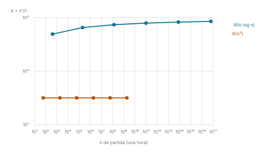

# Ejercicio 1

> 1. ★ Una computadora mil veces más rápida. ¿Cuánto crece el tamaño de entrada que se
>    resuelve en una hora con un algoritmo $\Theta(n^2)$? ¿Y con uno $\Theta(n \log n)$?
>    Estima los dos factores. (C1)

## 1. Problema

En una hora, una computadora hace $B$ operaciones; una mil veces más rápida hace
$1000B$ en el mismo tiempo. Un algoritmo cuesta $T(n)$ operaciones en el peor caso sobre
entradas de tamaño $n$. Sea $n$ el mayor tamaño con $T(n) \le B$ y $n'$ el mayor con
$T(n') \le 1000B$. Se pide estimar el factor $k = n'/n$. Modelo: RAM, contando
operaciones.

## 2. Planteamiento

El orden $\Theta(g)$ fija el costo salvo una constante, y para las entradas que se
resuelven en una hora el término dominante es el que cuenta, así que tomamos
$T(n) = c\, g(n)$ con $c > 0$. El tamaño $n$ gasta todo el presupuesto $B$ y $n'$ gasta
$1000B$:

$$c\, g(n') = 1000\, c\, g(n), \qquad \text{es decir,} \qquad g(n') = 1000\, g(n).$$

La constante $c$ y el presupuesto $B$ desaparecen de la ecuación. Como $g$ es creciente,
$n' > n$, o sea $k > 1$.

## 3. Caso $\Theta(n^2)$

La ecuación es $n'^2 = 1000\, n^2$, de donde

$$k = \frac{n'}{n} = \sqrt{1000} \approx 31{,}6.$$

El factor no depende de $n$: es el mismo para cualquier velocidad de partida.

## 4. Caso $\Theta(n \log n)$

Con $n' = kn$ y $\log(kn) = \log n + \log k$, la ecuación $kn \log(kn) = 1000\, n \log n$
queda

$$k\,(\log n + \log k) = 1000 \log n.$$

Aquí $n$ no se cancela, así que no hay un factor único: depende del tamaño de partida.
Lo acotamos.

- Como $k > 1$, $\log k > 0$, el paréntesis es mayor que $\log n$ y por tanto
  $k < 1000$.
- Como $k < 1000$, $\log k < \log 1000$, y despejando,

$$k > \frac{1000 \log n}{\log n + \log 1000} = \frac{1000}{1 + \log 1000 / \log n}.$$

Las cotas solo dependen del cociente $\log 1000 / \log n$, que es el mismo en cualquier
base. Cuando $n$ crece, ese cociente tiende a 0 y $k$ se acerca a 1000.

Para dar un número hay que fijar la velocidad. Con $10^9$ operaciones por segundo y
$c = 1$, el presupuesto es $B = 3{,}6 \cdot 10^{12}$, el tamaño de partida es
$n \approx 9{,}86 \cdot 10^{10}$ y $\log_2 n \approx 36{,}5$. Las cotas dan
$785{,}6 < k < 1000$, y resolviendo la ecuación numéricamente, $k \approx 791$.

Las dos ecuaciones, $n \log_2 n = B$ para el tamaño y la de arriba para el factor, se
resuelven por bisección (el código completo está en
[`codigo/ejercicio-01.py`](codigo/ejercicio-01.py)):

```python
def biseccion(f, bajo, alto, pasos=200):
    # raíz de una f creciente con f(bajo) < 0 < f(alto)
    for _ in range(pasos):
        medio = (bajo + alto) / 2
        if f(medio) < 0:
            bajo = medio
        else:
            alto = medio
    return bajo

B = 3600 * 10**9                        # una hora a 10^9 operaciones por segundo
n = biseccion(lambda n: n * math.log2(n) - B, 2, B)
cota = 1000 / (1 + math.log(1000) / math.log(n))
k = biseccion(lambda k: k * (math.log(n) + math.log(k)) - 1000 * math.log(n), 1, 1000)
print(f"B = {B:.1e}, n = {n:.3e}, log2 n = {math.log2(n):.1f}")
print(f"{cota:.1f} < k = {k:.1f} < 1000")
```

```text
B = 3.6e+12, n = 9.857e+10, log2 n = 36.5
785.6 < k = 791.4 < 1000
```

## 5. Comprobación

Buscando directamente el mayor $n$ que cabe en cada presupuesto, con
$B = 3{,}6 \cdot 10^{12}$: para $n^2$, de $1{,}897 \cdot 10^6$ a $6{,}0 \cdot 10^7$
(factor 31,6); para $n \log_2 n$, de $9{,}857 \cdot 10^{10}$ a $7{,}801 \cdot 10^{13}$
(factor 791,4).

La búsqueda es `mayor_n`, de la conferencia 1, §7. Antes de usarla se compara con una
fuerza bruta que prueba $n = 2, 3, \ldots$ uno por uno:

```python
def mayor_n(costo, presupuesto):
    # el mayor n con costo(n) <= presupuesto, por búsqueda binaria
    alto = 2
    while costo(alto) <= presupuesto:
        alto *= 2
    bajo = alto // 2
    while bajo + 1 < alto:
        medio = (bajo + alto) // 2
        if costo(medio) <= presupuesto:
            bajo = medio
        else:
            alto = medio
    return bajo

def mayor_n_fuerza_bruta(costo, presupuesto):
    n = 2
    while costo(n + 1) <= presupuesto:
        n += 1
    return n

costos = {"n^2": lambda n: n * n, "n log2 n": lambda n: n * math.log2(n)}

casos = [(c, p) for c in costos.values() for p in range(4, 20_001, 37)]
fallos = sum(mayor_n(c, p) != mayor_n_fuerza_bruta(c, p) for c, p in casos)
print(f"mayor_n contra fuerza bruta: {len(casos)} casos, {fallos} fallos\n")

for nombre, costo in costos.items():
    n0, n1 = mayor_n(costo, B), mayor_n(costo, 1000 * B)
    print(f"{nombre:>9}  {n0:>18,} -> {n1:>22,}   factor {n1 / n0:.1f}")
```

```text
mayor_n contra fuerza bruta: 1082 casos, 0 fallos

      n^2           1,897,366 ->             60,000,000   factor 31.6
 n log2 n      98,574,774,544 ->     78,008,697,597,778   factor 791.4
```

El factor medido de $n \log n$ es el de la ecuación de la sección 4, aunque allí se
supuso que $n$ gasta todo el presupuesto y en realidad $T(n) \le B < T(n+1)$.

Repitiendo con otras velocidades de partida, y comprobando en cada una lo que dicen las
secciones 3 y 4:

```python
print(f"{'op/s':>6} {'n de partida':>13} {'k (n^2)':>8} {'cota inf.':>10} {'k (n log n)':>12}")
filas, peor, n_peor = [], 0.0, None
for e in range(0, 16, 3):
    p = 3600 * 10**e
    n0 = mayor_n(costos["n log2 n"], p)
    k_med = mayor_n(costos["n log2 n"], 1000 * p) / n0
    m0 = mayor_n(costos["n^2"], p)
    k2 = mayor_n(costos["n^2"], 1000 * p) / m0
    cota = 1000 / (1 + math.log(1000) / math.log(n0))
    k_ec = biseccion(lambda k: k * (math.log(n0) + math.log(k)) - 1000 * math.log(n0), 1, 1000)
    assert abs(k2 - math.sqrt(1000)) < 0.01          # sección 3
    assert cota < k_med < 1000                       # sección 4
    dif = abs(k_ec - k_med) / k_med
    assert dif < 1 / n0 + 1e-12      # la ecuación predice lo medido (+ redondeo de float)
    if dif > peor:
        peor, n_peor = dif, n0
    filas.append((n0, k_med, m0, k2))
    print(f"{'10^' + str(e):>6} {n0:>13.2e} {k2:>8.2f} {cota:>10.1f} {k_med:>12.1f}")
assert all(a[1] < b[1] for a, b in zip(filas, filas[1:]))   # k crece con n
print(f"comprobado en {len(filas)} velocidades, sin fallos;"
      f" ecuación contra medida: diferencia máxima {peor:.1e} (n = {n_peor})")
```

```text
  op/s  n de partida  k (n^2)  cota inf.  k (n log n)
  10^0      4.14e+02    31.62      465.9        493.0
  10^3      2.04e+05    31.63      639.0        653.5
  10^6      1.33e+08    31.62      730.3        739.1
  10^9      9.86e+10    31.62      785.6        791.4
 10^12      7.80e+13    31.62      822.4        826.5
 10^15      6.45e+16    31.62      848.6        851.6
comprobado en 6 velocidades, sin fallos; ecuación contra medida: diferencia máxima 2.3e-04 (n = 414)
```

La columna de $n^2$ no cambia. La de $n \log n$ crece con $n$ y queda siempre entre las
cotas, pero despacio: con $10^{15}$ operaciones por segundo vale 851,6. La ecuación y la
medida solo difieren por redondear $n$ a un entero, y la diferencia es menor que $1/n$; la
mayor, $2{,}3 \cdot 10^{-4}$, es la de $n = 414$.



*Figura 1. El factor $k$ de la tabla anterior. El de $n^2$ es la recta plana en
$\sqrt{1000}$; el de $n \log n$ sube hacia 1000, la línea de $10^3$, sin llegar. A la misma
velocidad, $n^2$ parte de un $n$ menor.*

## 6. Conclusión

Con una computadora mil veces más rápida, el tamaño que se resuelve en una hora se
multiplica por $\sqrt{1000} \approx 31{,}6$ con un algoritmo $\Theta(n^2)$, sea cual sea la
velocidad de partida. Con uno $\Theta(n \log n)$ se multiplica por un factor algo menor
que 1000, entre $1000/(1 + \log 1000/\log n)$ y 1000, que se acerca a 1000 cuanto mayor es
$n$: unas 791 veces para una máquina de $10^9$ operaciones por segundo. El
$\Theta(n \log n)$ aprovecha la máquina nueva casi como uno lineal; el $\Theta(n^2)$, solo
con la raíz cuadrada.
