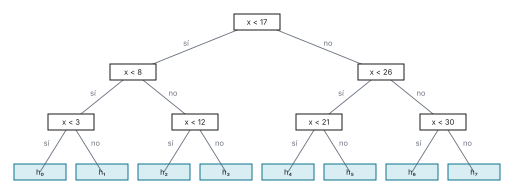

# Ejercicio 2

> 2. ★ Da el invariante y el potencial de la búsqueda binaria, y la cota de información
>    que la hace óptima. (C3, C5)

## 1. Problema

Dado $A[0..n-1]$ con $A[0] < \cdots < A[n-1]$ y un valor $x$, devolver $m$ con
$A[m] = x$, o $-1$ si $x$ no está. Modelo: comparaciones de $x$ con elementos de $A$, con
respuesta $<$, $=$ o $>$.

## 2. Algoritmo

Búsqueda binaria con ventana $A[lo : hi]$: empieza en $lo = 0$, $hi = n$; mientras
$lo < hi$, compara $x$ con $A[m]$, $m = \lfloor (lo + hi)/2 \rfloor$; si son iguales devuelve
$m$, si $x < A[m]$ hace $hi \leftarrow m$, si no $lo \leftarrow m + 1$. Al salir devuelve
$-1$.

En [`codigo/ejercicio-02.py`](codigo/ejercicio-02.py):

```python
def busqueda_binaria(A, x):
    lo, hi = 0, len(A)                              # ventana A[lo:hi], hi excluido
    while lo < hi:
        m = (lo + hi) // 2
        if A[m] == x:
            return m
        if x < A[m]:
            hi = m                                  # x < A[m]: fuera m y su derecha
        else:
            lo = m + 1                              # x > A[m]: fuera m y su izquierda
    return -1
```

## 3. Invariante

Al principio de cada vuelta, si $x$ está en $A$, está en $A[lo : hi]$ (C3, §1).
Inicialización: la ventana es todo $A$. Mantenimiento: con $lo < hi$ se tiene
$lo \le m < hi$. Si $A[m] = x$ devuelve $m$, correcto. Si $x < A[m]$ y $A[j] = x$, por el
orden $j < m$, así que $x$ está en $A[lo : m]$. Si $x > A[m]$, $j > m$ y $x$ está en
$A[m+1 : hi]$. Conclusión: al salir, $lo \ge hi$ y la ventana está vacía, así que $x$ no
está y $-1$ es correcto.

## 4. Potencial

$\Phi = hi - lo$: entero, $\ge 0$ (vale $\ge 1$ al empezar cada vuelta, y $m - lo$ o
$hi - m - 1$, ambos $\ge 0$, al terminarla), y baja estrictamente en cada vuelta, a
$m - lo < hi - lo$ o a $hi - m - 1 < hi - lo$. Termina. Además, en cada vuelta pasa a ser
a lo sumo $\lfloor \Phi/2 \rfloor$, así que hace a lo sumo
$\lfloor \log_2 n \rfloor + 1 = \lceil \log_2 (n+1) \rceil$ comparaciones.

Comprobado con una versión vigilada, que verifica el invariante y la bajada de $\Phi$ en
cada vuelta, contra una búsqueda lineal, para todo $n$ hasta 399 y todo $x$: un valor por
elemento y uno por hueco.

```python
def busqueda_binaria_vigilada(A, x):
    # la misma búsqueda, comprobando el invariante y el potencial en cada vuelta
    lo, hi = 0, len(A)
    vueltas = 0
    while lo < hi:
        assert all(A[j] != x for j in range(len(A)) if not lo <= j < hi)   # invariante
        phi = hi - lo
        vueltas += 1
        m = (lo + hi) // 2
        if A[m] == x:
            return m, vueltas
        if x < A[m]:
            hi = m
        else:
            lo = m + 1
        assert 0 <= hi - lo <= phi // 2                                          # potencial
    return -1, vueltas

def busqueda_lineal(A, x):
    return next((j for j, a in enumerate(A) if a == x), -1)

busquedas = 0
for n in range(1, 400):
    A = list(range(2, 2 * n + 1, 2))                # 2, 4, ..., 2n
    peor = 0
    for x in range(1, 2 * n + 2):                   # pares: están; impares: un valor por hueco
        r, vueltas = busqueda_binaria_vigilada(A, x)
        assert r == busqueda_lineal(A, x) == busqueda_binaria(A, x)
        peor = max(peor, vueltas)
        busquedas += 1
    assert peor == math.ceil(math.log2(n + 1))
print(f"n de 1 a 399: {busquedas:,} búsquedas, 0 fallos")
print("invariante y Φ ≤ ⌊Φ/2⌋ comprobados en cada vuelta")
print("peor caso = ⌈log2(n + 1)⌉ comparaciones para todo n")
```

```text
n de 1 a 399: 159,999 búsquedas, 0 fallos
invariante y Φ ≤ ⌊Φ/2⌋ comprobados en cada vuelta
peor caso = ⌈log2(n + 1)⌉ comparaciones para todo n
```

## 5. Cota de información

Todo algoritmo de comparaciones necesita $\lceil \log_2 (n+1) \rceil$ en el peor caso. Si
$x$ no está, cae en uno de los $n + 1$ huecos y ninguna comparación responde "$=$", así
que esas entradas recorren un árbol de decisión binario. Dos valores en huecos distintos
llegan a hojas distintas: si no, el algoritmo no comparó con ningún $a$ entre ellos, y
$x = a$ seguiría el mismo camino y oiría "no está". Son $n + 1$ hojas, y un árbol binario
de altura $h$ tiene a lo sumo $2^h$ (C5, §3).



*Figura 1. El árbol de decisión de la búsqueda binaria sobre
$A = [3, 8, 12, 17, 21, 26, 30]$, obtenido corriéndola con un valor de cada hueco (como la
figura 7 de la C5). Ocho hojas y altura $3 = \lceil \log_2 8 \rceil$.*

## 6. Conclusión

La búsqueda binaria es correcta y óptima en el modelo de comparaciones: su peor caso es
exactamente la cota, $\lceil \log_2 (n+1) \rceil$.
