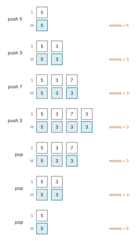

# Ejercicio 3

> 3. ★ Una pila con una operación `minimo` que cuesta $O(1)$ en el peor caso. Diseña la
>    estructura, enuncia el invariante que la hace correcta y da el costo de cada
>    operación. (C3)

## 1. Problema

Una pila de elementos de un orden total, con las operaciones `push(x)`, `pop()` y
`minimo()`. `minimo()` devuelve, sin modificar la pila, el menor de sus elementos, y debe
costar $O(1)$ en el peor caso. `pop()` y `minimo()` requieren pila no vacía. Modelo: word
RAM.

## 2. Algoritmo

Mantener dos pilas paralelas: $S$ (elementos) y $M$ (mínimos acumulados). En
[`codigo/ejercicio-03.py`](codigo/ejercicio-03.py):

```python
class PilaMin:
    def __init__(self):
        self.S, self.M = [], []

    def push(self, x):
        self.M.append(x if not self.M else min(self.M[-1], x))
        self.S.append(x)

    def pop(self):
        self.M.pop()
        return self.S.pop()

    def minimo(self):
        return self.M[-1]
```

## 3. Correctitud

- **Invariante:** Tras procesar $k$ elementos ($|S| = k$), para todo $i \in \{1, \ldots, k\}$,
  $M[i] = \min_{1 \le j \le i} S[j]$.
- **Inicialización:** Con $k = 0$, $S$ y $M$ están vacías ($|S| = |M| = 0$) y la propiedad
  se cumple trivialmente sobre el conjunto vacío.
- **Mantenimiento:** Si se cumple para $k$, al hacer `push(x)` se calcula
  $M[k+1] = \min(x, M[k]) = \min\left(x, \min_{1 \le j \le k} S[j]\right) = \min_{1 \le j \le k+1} S[j]$;
  si $k = 0$, $M[1] = x = S[1]$. Al hacer `pop()`, se desapilan $S[k]$ y $M[k]$,
  preservando la propiedad para $M[1 \ldots k-1]$. `minimo()` no altera el estado.
- **Conclusión:** Con $|S| = k \ge 1$, la cima $M[top] = M[k] = \min_{1 \le j \le k} S[j]$,
  que es el mínimo de toda la pila.
- **Terminación:** Las tres operaciones son secuencias finitas de instrucciones primitivas
  de costo constante $O(1)$, sin bucles ni recursión.



*Figura 1. Siete operaciones sobre `PilaMin` y el estado de $S$ y $M$ después de cada una.
La cima de $M$, recuadrada, es siempre el mínimo de $S$. Con el 3 repetido, el primer
`pop` quita una copia y el mínimo sigue siendo 3.*

Comprobado con secuencias al azar de `push` y `pop` contra una lista sin trucos,
verificando el invariante después de cada operación. Los valores van de 0 a 4 para que
haya muchos repetidos:

```python
def comprobar_invariante(p):
    # M[i] es el mínimo de S[0..i], para cada i
    assert len(p.M) == len(p.S)
    assert all(p.M[i] == min(p.S[:i + 1]) for i in range(len(p.S)))

random.seed(1)
operaciones = 0
for _ in range(3000):
    p, modelo = PilaMin(), []                   # modelo: una lista sin trucos
    for _ in range(random.randint(1, 30)):
        if modelo and random.random() < 0.4:
            assert p.pop() == modelo.pop()
        else:
            x = random.randint(0, 4)            # valores pequeños: muchos repetidos
            p.push(x)
            modelo.append(x)
        comprobar_invariante(p)
        if modelo:
            assert p.minimo() == min(modelo)
        operaciones += 1
print(f"invariante y minimo comprobados tras {operaciones:,} operaciones, sin fallos")
```

```text
invariante y minimo comprobados tras 46,289 operaciones, sin fallos
```

## 4. Costo

`push`, `pop` y `minimo` cuestan $O(1)$ tiempo en el peor caso, con $S$ y $M$ como
arreglos de capacidad fija (con listas de Python, `append` es $O(1)$ amortizado). Memoria
auxiliar $O(n)$ para la pila $M$.

## 5. Conclusión

Las tres operaciones cuestan $O(1)$ en el peor caso.
