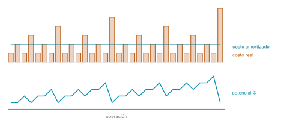

# Ejercicio 4

> 4. ★★ El contador binario en una máquina de Turing, del ejercicio 7 de la conferencia 1.
>    Demuestra con un potencial que $m$ incrementos desde 0 cuestan $O(m)$ pasos en
>    total, aunque uno solo pueda costar $\Theta(\log m)$. Es la pregunta que la
>    conferencia 1 dejó abierta. (C1, C4)

## 1. Problema

En la cinta de una máquina de Turing de una cinta está escrito un número $n$ en binario,
con el bit más significativo a la izquierda, en $b = \lfloor \log_2 n \rfloor + 1$ celdas, y
el blanco `$` a los dos lados. El cabezal empieza en el bit menos significativo. La
máquina deja escrito $n + 1$ y se traba con el cabezal otra vez en el bit menos
significativo, y se aplica $m$ veces seguidas empezando desde 0, escrito en una sola
celda. Modelo: máquina de Turing de una cinta; el costo es el número de pasos, es decir,
de transiciones aplicadas hasta que se traba.

## 2. Algoritmo

$M = (Q, \Sigma, \Gamma, \delta, q_0, F, B)$ con $Q = \{q_0, q_1, q_2\}$, $\Sigma = \{0, 1\}$,
$\Gamma = \{0, 1, \$\}$, $B = \$$ y $F = \{q_2\}$. En $q_0$ se propaga el acarreo hacia la
izquierda: cada 1 pasa a 0, y el primer 0 o `$` pasa a 1. En $q_1$ se camina a la derecha
sin cambiar nada hasta el `$` que sigue al bit menos significativo, y se da un paso atrás
hasta $q_2$, donde no hay transición y la máquina se traba en un estado final.

| Estado | Lee | Escribe | Movimiento | Nuevo estado |
|---|---|---|---|---|
| $q_0$ | 1 | 0 | L | $q_0$ |
| $q_0$ | 0 | 1 | R | $q_1$ |
| $q_0$ | `$` | 1 | R | $q_1$ |
| $q_1$ | 0 | 0 | R | $q_1$ |
| $q_1$ | 1 | 1 | R | $q_1$ |
| $q_1$ | `$` | `$` | L | $q_2$ |

La máquina, simulada transición a transición en
[`codigo/ejercicio-04.py`](codigo/ejercicio-04.py), con la tabla de arriba como $\delta$:

```python
delta = {                               # (estado, lee) -> (escribe, movimiento, nuevo estado)
    ("q0", "1"): ("0", -1, "q0"),
    ("q0", "0"): ("1", +1, "q1"),
    ("q0", "$"): ("1", +1, "q1"),
    ("q1", "0"): ("0", +1, "q1"),
    ("q1", "1"): ("1", +1, "q1"),
    ("q1", "$"): ("$", -1, "q2"),
}

def incrementar(cinta, cabeza):
    # aplica δ hasta que la máquina se traba; devuelve la cabeza y el número de pasos
    estado, pasos = "q0", 0
    while (estado, cinta.get(cabeza, "$")) in delta:
        escribe, movimiento, estado = delta[(estado, cinta.get(cabeza, "$"))]
        cinta[cabeza] = escribe
        cabeza += movimiento
        pasos += 1
    assert estado == "q2"                       # se traba en el estado final
    return cabeza, pasos

def leer(cinta):
    return int("".join(cinta[i] for i in sorted(cinta) if cinta[i] != "$"), 2)

M = 10_000
cinta, cabeza = {0: "0"}, 0                     # el 0 escrito en una sola celda
costos, potencial = [], [0]
for i in range(1, M + 1):
    cabeza, c = incrementar(cinta, cabeza)
    assert leer(cinta) == i                                          # deja escrito n + 1
    assert cinta[cabeza] != "$" and cinta.get(cabeza + 1, "$") == "$"  # cabezal en el bit menos significativo
    costos.append(c)
    potencial.append(2 * list(cinta.values()).count("1"))
print(f"{M:,} incrementos desde 0: después de cada uno la cinta dice n + 1")
print("y el cabezal está otra vez en el bit menos significativo")
```

```text
10,000 incrementos desde 0: después de cada uno la cinta dice n + 1
y el cabezal está otra vez en el bit menos significativo
```

## 3. Costo de un incremento

Si $n$ termina en exactamente $k$ unos, en $q_0$ la máquina da $k + 1$ pasos: $k$ sobre los
unos y uno sobre el 0 o `$` que sigue. En $q_1$ da $k$ pasos de regreso sobre esas mismas
celdas y uno más sobre el `$` de la derecha, que la lleva a $q_2$. El incremento cuesta

$$c = 2k + 2.$$

En $m$ incrementos desde 0, antes del $i$-ésimo está escrito $i - 1 \le m - 1$. Si termina
en $k$ unos, entonces $2^k - 1 \le m - 1$, así que $k \le \lfloor \log_2 m \rfloor$, y la
igualdad se alcanza con $i - 1 = 2^{\lfloor \log_2 m \rfloor} - 1$. El incremento más caro
cuesta $2\lfloor \log_2 m \rfloor + 2 = \Theta(\log m)$ pasos. Multiplicar ese peor caso por
$m$ da $O(m \log m)$, que es verdadero pero no ajustado.

El incremento de 7 = 111 a 8 = 1000, con $k = 3$, paso a paso (el cabezal, entre corchetes):

| paso | estado | lee | escribe | mueve | cinta después |
|---|---|---|---|---|---|
| 0 | | | | | `$ $ 1 1 [1] $` |
| 1 | q0 → q0 | `1` | `0` | L | `$ $ 1 [1] 0 $` |
| 2 | q0 → q0 | `1` | `0` | L | `$ $ [1] 0 0 $` |
| 3 | q0 → q0 | `1` | `0` | L | `$ [$] 0 0 0 $` |
| 4 | q0 → q1 | `$` | `1` | R | `$ 1 [0] 0 0 $` |
| 5 | q1 → q1 | `0` | `0` | R | `$ 1 0 [0] 0 $` |
| 6 | q1 → q1 | `0` | `0` | R | `$ 1 0 0 [0] $` |
| 7 | q1 → q1 | `0` | `0` | R | `$ 1 0 0 0 [$]` |
| 8 | q1 → q2 | `$` | `$` | L | `$ 1 0 0 [0] $` |

Con los pasos contados por la simulación:

```python
for i, c in enumerate(costos, start=1):
    b = bin(i - 1)
    k = len(b) - len(b.rstrip("1"))             # unos en que termina i - 1
    assert c == 2 * k + 2
print("c = 2k + 2 en todos los incrementos\n")
for m in (10, 100, 1_000, 10_000):
    caro = max(costos[:m])
    i = costos.index(caro) + 1
    assert caro == 2 * math.floor(math.log2(m)) + 2
    assert i - 1 == 2 ** math.floor(math.log2(m)) - 1
    print(f"m = {m:>6,}: el más caro cuesta {caro:>2} pasos, el que parte de {i - 1:,}")
```

```text
c = 2k + 2 en todos los incrementos

m =     10: el más caro cuesta  8 pasos, el que parte de 7
m =    100: el más caro cuesta 14 pasos, el que parte de 63
m =  1,000: el más caro cuesta 20 pasos, el que parte de 511
m = 10,000: el más caro cuesta 28 pasos, el que parte de 8,191
```

## 4. Potencial

Cada 1 escrito en la cinta es una deuda: el acarreo que lo alcance va a pasar por esa
celda dos veces, una al ir, para volverla 0, y otra al volver. Definimos, para la cinta
después del incremento $i$,

$$\Phi_i = 2 \cdot (\text{número de unos escritos en la cinta}),$$

y el costo amortizado del incremento $i$ como

$$\hat{c}_i = c_i + \Phi_i - \Phi_{i-1}.$$

La cinta empieza con un 0, así que $\Phi_0 = 0$, y $\Phi_i \ge 0$ para todo $i$, porque
cuenta celdas. Si antes del incremento $i$ el número termina en $k$ unos, el incremento
vuelve 0 esos $k$ unos y escribe un solo 1. El número de unos cambia en $1 - k$, y

$$\hat{c}_i = (2k + 2) + 2(1 - k) = 4.$$

Sumando sobre los $m$ incrementos, los términos del potencial se telescopian:

$$\sum_{i=1}^{m} c_i = \sum_{i=1}^{m} \hat{c}_i - \Phi_m + \Phi_0 = 4m - \Phi_m \le 4m,$$

donde la desigualdad usa $\Phi_m \ge 0 = \Phi_0$.

Con los pasos y el potencial de la simulación:

```python
amortizados = [c + potencial[i] - potencial[i - 1] for i, c in enumerate(costos, start=1)]
assert all(a == 4 for a in amortizados)
print(f"costo amortizado = 4 en los {M:,} incrementos\n")
for m in (10, 100, 1_000, 10_000):
    total = sum(costos[:m])
    assert total == 4 * m - potencial[m] <= 4 * m
    print(f"m = {m:>6,}: total {total:>6,}   4m − Φₘ = {4 * m - potencial[m]:>6,}"
          f"   4m = {4 * m:>6,}")
```

```text
costo amortizado = 4 en los 10,000 incrementos

m =     10: total     36   4m − Φₘ =     36   4m =     40
m =    100: total    394   4m − Φₘ =    394   4m =    400
m =  1,000: total  3,988   4m − Φₘ =  3,988   4m =  4,000
m = 10,000: total 39,990   4m − Φₘ = 39,990   4m = 40,000
```



*Figura 1. Los primeros 32 incrementos de la simulación. Las barras son el costo real
$c_i = 2k + 2$, con picos en los acarreos largos (el último pasa de 31 a 32). La línea es
el costo amortizado, siempre 4. Abajo, el potencial: sube 2 en cada incremento sin
acarreo y cae justo en los picos, lo mismo que costó el acarreo de más.*

## 5. Conclusión

$m$ incrementos desde 0 cuestan a lo sumo $4m$ pasos, $O(m)$ en total: el costo amortizado
de un incremento es 4, para toda secuencia de incrementos desde 0, aunque un incremento
solo cueste $2\lfloor \log_2 m \rfloor + 2 = \Theta(\log m)$ pasos.
