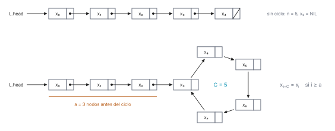
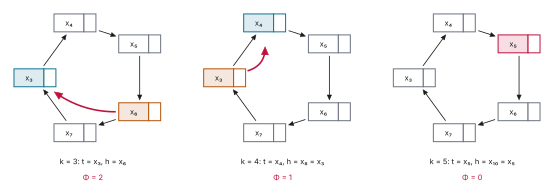

# Ejercicio 5

> 5. ★★ Detección de ciclos en una lista enlazada con dos punteros que avanzan a
>    velocidades 1 y 2 (algoritmo de Floyd). Demuestra que se encuentran si y solo si hay
>    un ciclo, con un invariante, y que termina, con un potencial. Da el costo. (C3)

## 1. Problema

Dada una lista simplemente enlazada con cabeza $L.head$, decidir si tiene un ciclo.
Numeramos los nodos por su distancia desde la cabeza: $x_0 = L.head$ y
$x_{i+1} = x_i$.`next`. Si la lista no tiene ciclo, tiene $n$ nodos distintos
$x_0, \ldots, x_{n-1}$ y termina en $x_n = $ `NIL`. Si tiene ciclo, llamamos $a \ge 0$ al
número de nodos antes de entrar al ciclo y $C \ge 1$ al número de nodos del ciclo
($n = a + C$); entonces ningún $x_i$ es `NIL`. Dentro del ciclo, avanzar $C$ pasos devuelve
al mismo nodo, y avanzar entre 1 y $C - 1$ pasos lleva a otro nodo. Modelo: word RAM; a un
nodo solo se llega siguiendo `next` desde la cabeza, y cada acceso a `next` y cada
comparación de punteros cuesta 1.



*Figura 1. Las dos formas de la entrada. Abajo, $a = 3$ y $C = 5$.*

## 2. Algoritmo

Dos punteros desde la cabeza: la tortuga $t$ avanza 1 nodo por vuelta y la liebre $h$
avanza 2. Si se encuentran, hay ciclo; si la liebre llega a `NIL`, no lo hay. En
[`codigo/ejercicio-05.py`](codigo/ejercicio-05.py):

```python
class Nodo:
    def __init__(self):
        self.next = None

def floyd(cabeza):
    t = h = cabeza
    while h is not None and h.next is not None:
        t = t.next
        h = h.next.next
        if t is h:
            return True
    return False
```

## 3. Correctitud

- *Invariante:* tras $k$ vueltas, $t = x_k$ y $h = x_{2k}$, es decir, la tortuga está a $k$
  pasos de la cabeza y la liebre a $2k$.
- *Inicialización:* con $k = 0$, $t = h = x_0$.
- *Mantenimiento:* si se cumple para $k$ y se ejecuta la vuelta, $t$ avanza un nodo hasta
  $x_{k+1}$ y $h$ avanza dos hasta $x_{2k+2}$, así que se cumple para $k + 1$.
- *Conclusión ($\Rightarrow$):* sin ciclo, los nodos $x_i$ son todos distintos, y con
  $k \ge 1$ se tiene $k \ne 2k$, así que $t \ne h$ en toda vuelta. El algoritmo nunca
  devuelve `True` y, cuando la liebre llega a `NIL`, devuelve `False`. Por
  contrarrecíproca, si los punteros se encuentran, hay ciclo. Con ciclo ningún $x_i$ es
  `NIL`, así que si el algoritmo devuelve `False`, la lista no tiene ciclo.

## 4. Terminación

- *Sin ciclo:* sea $\Phi = n - 2k$, el número de nodos entre la liebre y `NIL`. Al principio
  $\Phi = n$. Cada vuelta la liebre avanza dos nodos, así que $\Phi$ baja en 2. Y
  $\Phi \ge 0$ siempre. El ciclo termina después de a lo sumo $\lfloor n/2 \rfloor$ vueltas.
- *Con ciclo ($\Leftarrow$):* tras $k_0 = \max(a, 1)$ vueltas, la tortuga está en el ciclo,
  y la liebre también, porque $2k_0 \ge k_0 \ge a$. Sea $\Phi$ el número de pasos que la
  liebre tiene que dar por el ciclo para llegar al nodo de la tortuga. Es un entero con
  $0 \le \Phi \le C - 1$, y $\Phi = 0$ si y solo si $t = h$. Mientras $t \ne h$, cada vuelta
  acerca la liebre dos pasos y aleja la tortuga uno, así que $\Phi$ baja en 1. Y
  $\Phi \ge 0$ siempre. El ciclo termina después de a lo sumo $C - 1$ vueltas más, con
  $t = h$, y el algoritmo devuelve `True`.

La lista de la figura 1, con $a = 3$ y $C = 5$, vuelta a vuelta:

| vueltas | tortuga | liebre | Φ |
|---|---|---|---|
| 0 | x₀ | x₀ | — |
| 1 | x₁ | x₂ | — |
| 2 | x₂ | x₄ | — |
| 3 | x₃ | x₆ | 2 |
| 4 | x₄ | x₈ = x₃ | 1 |
| 5 | x₅ | x₁₀ = x₅ | 0 |



*Figura 2. El potencial $\Phi$ con $a = 3$, $C = 5$ y $k_0 = 3$, tomado de una ejecución del
algoritmo. Tortuga en azul, liebre en naranja; el arco rojo son los $\Phi$ pasos que le
faltan a la liebre.*

Comprobado con una versión vigilada del algoritmo, que verifica el invariante y los dos
potenciales en cada vuelta, sobre todas las listas sin ciclo de hasta 200 nodos y todas
las listas con $a \le 40$ y $C \le 40$:

```python
def lista(a, C):
    # a nodos antes del ciclo y C en el ciclo; con C = 0, una lista sin ciclo de a nodos
    x = [Nodo() for _ in range(a + C)]
    for i in range(len(x) - 1):
        x[i].next = x[i + 1]
    if C:
        x[-1].next = x[a]
    return x

def floyd_vigilado(x, a, C):
    # el mismo algoritmo, comprobando el invariante y el potencial en cada vuelta
    def nodo_x(i):                              # x_i, o None (NIL) si la lista se acaba
        if C == 0:
            return x[i] if i < len(x) else None
        return x[i] if i < a else x[a + (i - a) % C]
    pos = {id(v): i for i, v in enumerate(x)}
    t = h = (x[0] if x else None)
    k, phi = 0, None
    while h is not None and h.next is not None:
        t = t.next
        h = h.next.next
        k += 1
        assert t is nodo_x(k) and h is nodo_x(2 * k)              # invariante
        if C == 0:
            assert len(x) - 2 * k >= 0                            # Φ = n - 2k >= 0
        elif k >= max(a, 1):
            nuevo = (pos[id(t)] - pos[id(h)]) % C                 # pasos de h hasta t
            assert phi is None or nuevo == phi - 1                # Φ baja en 1
            phi = nuevo
        if t is h:
            return True, k
    return False, k

sin_ciclo = 0
for n in range(0, 201):
    x = lista(n, 0)
    r, vueltas = floyd_vigilado(x, n, 0)
    assert r is False is floyd(x[0] if x else None) and vueltas <= n // 2
    sin_ciclo += 1

con_ciclo = 0
for a in range(0, 41):
    for C in range(1, 41):
        x = lista(a, C)
        r, vueltas = floyd_vigilado(x, a, C)
        assert r is True is floyd(x[0]) and vueltas <= max(a, 1) + C - 1 <= a + C
        con_ciclo += 1
print(f"sin ciclo, n de 0 a 200: {sin_ciclo} listas, False en todas,"
      f" a lo sumo ⌊n/2⌋ vueltas")
print(f"con ciclo, a de 0 a 40 y C de 1 a 40: {con_ciclo:,} listas, True en todas,"
      f" a lo sumo n vueltas")
print("invariante t = xₖ, h = x₂ₖ y los dos potenciales comprobados en cada vuelta")
```

```text
sin ciclo, n de 0 a 200: 201 listas, False en todas, a lo sumo ⌊n/2⌋ vueltas
con ciclo, a de 0 a 40 y C de 1 a 40: 1,640 listas, True en todas, a lo sumo n vueltas
invariante t = xₖ, h = x₂ₖ y los dos potenciales comprobados en cada vuelta
```

## 5. Costo

A lo sumo $\lfloor n/2 \rfloor$ vueltas sin ciclo y $n$ con ciclo, y cada vuelta hace
$O(1)$ lecturas de `next` y comparaciones. Tiempo $O(n)$ en el peor caso. Memoria $O(1)$:
dos punteros.

## 6. Conclusión

El algoritmo de Floyd devuelve `True` si y solo si la lista tiene ciclo, termina, y cuesta
$O(n)$ en tiempo y $O(1)$ en memoria.
