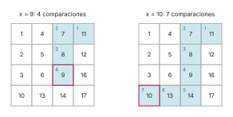
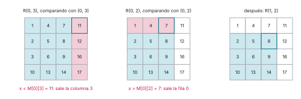
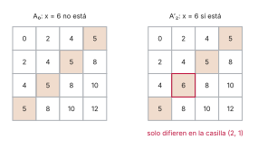

# Ejercicio 6

> 6. ★★ Una matriz $n \times n$ tiene filas y columnas ordenadas de forma creciente.
>    Diseña un algoritmo que decida si contiene un valor $x$ en $O(n)$ comparaciones,
>    demuestra su correctitud con un invariante, y demuestra con un adversario que no se
>    puede en $o(n)$. (C3, C5)

## 1. Problema

**Entrada.** Una matriz $M$ de $n \times n$, con filas y columnas numeradas de 0 a $n - 1$,
y un valor $x$.

**Precondición.** Las filas crecen hacia la derecha y las columnas crecen hacia abajo:

$$M[a][b] \le M[a][b+1] \quad \text{y} \quad M[a][b] \le M[a+1][b]$$

para todos los índices en rango. (Con $<$ en lugar de $\le$ todo sigue igual.) Por
transitividad, cada casilla es mayor o igual que todo lo que tiene a su izquierda en su fila
y encima en su columna, y menor o igual que todo lo que tiene a su derecha y debajo.

**Postcondición.** Devolver una posición $(i, j)$ con $M[i][j] = x$, o decir que $x$ no está
en $M$.

**Modelo.** Comparaciones: la única forma de saber algo de las casillas es comparar $x$ con
una de ellas, y cada comparación responde $<$, $=$ o $>$ con costo 1.

## 2. Algoritmo

Se empieza en la esquina de arriba a la derecha. Esa casilla es la mayor de su fila y la
menor de su columna, así que una sola comparación descarta una fila entera o una columna
entera, y lo que queda es otra vez una matriz ordenada con su propia esquina de arriba a la
derecha. En [`codigo/ejercicio-06.py`](codigo/ejercicio-06.py):

```python
def buscar_en_matriz(M, x, comparar):
    """Devuelve ("está", (i, j)) o ("no está", None)."""
    n = len(M)
    i, j = 0, n - 1              # invariante: si x está, está en M[i..n-1][0..j]
    while i < n and j >= 0:
        r = comparar(x, M[i][j])        # -1, 0 o 1
        if r == 0:
            return ("está", (i, j))
        if r < 0:
            j -= 1               # x es menor que toda la columna j, desde la fila i
        else:
            i += 1               # x es mayor que toda la fila i, hasta la columna j
    return ("no está", None)
```

**Ejemplo.** Con la matriz de la figura 1 y $x = 9$, el algoritmo compara con 11, 7, 8, 9:
cuatro comparaciones. Con $x = 10$ recorre toda la matriz hasta la esquina opuesta: 11, 7,
8, 9, 14, 13, 10, siete comparaciones.

```python
def contando(registro):
    # una función comparar que anota con qué casilla se comparó
    def comparar(x, y):
        registro.append(y)
        return (x > y) - (x < y)
    return comparar

M = [[1, 4, 7, 11],
     [2, 5, 8, 12],
     [3, 6, 9, 16],
     [10, 13, 14, 17]]
for x in (9, 10):
    registro = []
    resultado = buscar_en_matriz(M, x, contando(registro))
    print(f"x = {x:>2}: compara con {', '.join(map(str, registro))}"
          f"  ({len(registro)} comparaciones) -> {resultado}")
```

```text
x =  9: compara con 11, 7, 8, 9  (4 comparaciones) -> ('está', (2, 2))
x = 10: compara con 11, 7, 8, 9, 14, 13, 10  (7 comparaciones) -> ('está', (3, 0))
```



*Figura 1. El camino del algoritmo, con el orden de las comparaciones en cada casilla; en
rojo, la casilla donde encuentra $x$. Solo se mueve a la izquierda (descarta una columna) o hacia abajo (descarta una fila). El caso
de $x = 10$ es el más largo posible con $n = 4$: $2n - 1 = 7$.*

## 3. Correctitud: el invariante

**Notación.** Para $0 \le i \le n$ y $-1 \le j \le n - 1$, sea $R(i, j)$ el conjunto de
posiciones de las filas $i, \ldots, n - 1$ y las columnas $0, \ldots, j$:

$$R(i, j) = \{(a, b) : i \le a \le n - 1,\ 0 \le b \le j\}.$$

Si $i = n$ o $j = -1$, el rectángulo es vacío.

**Invariante.** Al comienzo de cada vuelta del `while`, y al salir de él: *si $x$ aparece en
$M$, aparece en alguna posición de $R(i, j)$.*

**Inicialización.** Antes de la primera vuelta $i = 0$ y $j = n - 1$, así que $R(0, n - 1)$
es la matriz entera. Si $x$ aparece en $M$, aparece en $R(0, n - 1)$.

**Mantenimiento.** Supongamos el invariante al comienzo de una vuelta, con $i < n$ y
$j \ge 0$, y sea $r$ la respuesta de comparar $x$ con $M[i][j]$. Hay tres casos, uno por rama
del `if`.

- Si $r = 0$, entonces $M[i][j] = x$ y el algoritmo devuelve $(i, j)$, que cumple la
  postcondición. No hay vuelta siguiente.
- Si $r < 0$, entonces $x < M[i][j]$. Para toda fila $a \ge i$, la columna $j$ crece hacia
  abajo, así que $M[a][j] \ge M[i][j] > x$. Entonces $x$ no está en ninguna posición de la
  columna $j$ dentro de $R(i, j)$. Si $x$ aparece en $M$, por el invariante está en
  $R(i, j)$, y no en su columna $j$, así que está en $R(i, j - 1)$. El algoritmo hace
  $j \leftarrow j - 1$, y el invariante vale para el estado nuevo.
- Si $r > 0$, entonces $x > M[i][j]$. Para toda columna $b \le j$, la fila $i$ crece hacia la
  derecha, así que $M[i][b] \le M[i][j] < x$. Entonces $x$ no está en la fila $i$ dentro de
  $R(i, j)$, y si aparece en $M$ está en $R(i + 1, j)$. El algoritmo hace
  $i \leftarrow i + 1$, y el invariante vale.



*Figura 2. Las dos primeras vueltas buscando $x = 9$. En azul, el rectángulo $R(i, j)$; en
rojo, lo que la comparación descarta: $9 < 11$ saca la columna 3 y $9 > 7$ saca la fila 0.
Lo que queda, $R(1, 2)$, es otra vez un rectángulo con la casilla que se compara en su
esquina de arriba a la derecha.*

**Conclusión.** Si el algoritmo devuelve dentro del ciclo, ya vimos que la respuesta es
correcta. Si sale del `while`, es porque $i = n$ o $j = -1$, y en los dos casos $R(i, j)$ es
vacío. Por el invariante, si $x$ apareciera en $M$ aparecería en un conjunto vacío, lo que es
imposible. Así que $x$ no está en $M$, y la respuesta "no está" es correcta. $\square$

Comprobado con el algoritmo vigilado, que verifica el invariante al comienzo de cada vuelta
y al salir, sobre matrices al azar con valores repetidos y cada $x$ desde menos que el mínimo
hasta más que el máximo:

```python
def matriz_al_azar(n, rng):
    # filas y columnas crecientes (no estrictamente), con valores repetidos
    A = [[0] * n for _ in range(n)]
    for a in range(n):
        for b in range(n):
            A[a][b] = max(A[a - 1][b] if a else 0, A[a][b - 1] if b else 0) + rng.randint(0, 2)
    return A

def buscar_vigilado(M, x):
    # el mismo algoritmo, comprobando el invariante al comienzo de cada vuelta y al salir
    n = len(M)
    i, j, comparaciones = 0, n - 1, 0
    esta = any(x in fila for fila in M)
    while True:
        en_R = any(M[a][b] == x for a in range(i, n) for b in range(0, j + 1))
        assert en_R or not esta                 # si x está en M, está en R(i, j)
        if not (i < n and j >= 0):
            return ("no está", None), comparaciones
        comparaciones += 1
        if M[i][j] == x:
            return ("está", (i, j)), comparaciones
        if x < M[i][j]:
            j -= 1
        else:
            i += 1

rng = random.Random(6)
casos = 0
peor = {}
for _ in range(4000):
    n = rng.randint(1, 9)
    A = matriz_al_azar(n, rng)
    for x in range(-1, A[-1][-1] + 2):
        (respuesta, p), c = buscar_vigilado(A, x)
        assert (respuesta == "está") == any(x in fila for fila in A)
        assert respuesta == "no está" or A[p[0]][p[1]] == x
        assert c <= 2 * n - 1
        peor[n] = max(peor.get(n, 0), c)
        casos += 1
print(f"{casos:,} búsquedas en matrices al azar con repetidos, n de 1 a 9: 0 fallos")
print("invariante comprobado al comienzo de cada vuelta y al salir")
print("peor caso medido:", ", ".join(f"n = {n}: {peor[n]}" for n in sorted(peor)))
assert all(peor[n] == 2 * n - 1 for n in peor)
```

```text
61,978 búsquedas en matrices al azar con repetidos, n de 1 a 9: 0 fallos
invariante comprobado al comienzo de cada vuelta y al salir
peor caso medido: n = 1: 1, n = 2: 3, n = 3: 5, n = 4: 7, n = 5: 9, n = 6: 11, n = 7: 13, n = 8: 15, n = 9: 17
```

## 4. Costo

Cada vuelta hace una comparación. Sea $p$ el número de veces que sube $i$ y $q$ el número de
veces que baja $j$. Mientras el ciclo sigue, $p \le n - 1$ y $q \le n - 1$; el ciclo sale en
cuanto $p = n$ o $q = n$, o devuelve antes. Así que el número de vueltas es a lo sumo
$(n - 1) + (n - 1) + 1 = 2n - 1$. Hay entradas que alcanzan ese número: si
$x = M[n-1][0]$ y es el único valor igual a $x$, el camino tiene que ir de la esquina
$(0, n - 1)$ a la $(n - 1, 0)$ moviéndose solo a la izquierda o hacia abajo, y hace
exactamente $n - 1$ pasos de cada tipo más la comparación final (figura 1, derecha).

**Costo.** A lo sumo $2n - 1$ comparaciones, y es ajustado. Es $O(n)$. Memoria extra $O(1)$:
dos índices.

## 5. Cota mínima

En el modelo de comparaciones, todo algoritmo necesita al menos $n$ comparaciones. Sean
$x = 2n - 2$ y $A_0[a][b] = 2(a + b)$ si $a + b \ne n - 1$, y $A_0[a][b] = 2n - 3$ si
$a + b = n - 1$. El valor solo depende de $a + b$ y crece estrictamente con él
($\cdots < 2n - 4 < 2n - 3 < 2n < \cdots$), así que $A_0$ es válida, y $x$ no aparece en ella.
Cada casilla $p$ de la antidiagonal tiene vecinas de valor $2n - 4$ a la izquierda y encima, y
$2n$ a la derecha y debajo, así que $A_0$ con $p$ cambiada a $x$ es válida y contiene $x$. Si
un algoritmo termina sin comparar $x$ con alguna casilla $p$ de la antidiagonal, sobre las dos
matrices recibe las mismas respuestas, porque solo difieren en $p$, y da la misma salida; se
equivoca en una de las dos. Así que compara las $n$ casillas de la antidiagonal (C5, §5). Con
el mismo argumento sobre las $n - 1$ casillas del nivel $a + b = n$, la cota es $2n - 1$.



*Figura 3. El adversario con $n = 4$ y $x = 2n - 2 = 6$. En naranja, la antidiagonal: cada
casilla está entre un 4 (izquierda y arriba) y un 8 (derecha y abajo), así que puede valer 5
o 6 sin romper el orden. A la derecha, la entrada que el adversario muestra si el algoritmo
nunca miró la casilla $(2, 1)$.*

Para cada $n$ hasta 10, el código construye $A_0$, comprueba que es válida y no contiene $x$,
y busca por fuerza bruta todas las casillas que se pueden cambiar a $x$ sin romper el orden:

```python
def A0(n):
    return [[2 * (a + b) if a + b != n - 1 else 2 * n - 3 for b in range(n)]
            for a in range(n)]

def valida(A):
    n = len(A)
    return all(A[a][b] <= A[a][b + 1] for a in range(n) for b in range(n - 1)) and \
           all(A[a][b] <= A[a + 1][b] for a in range(n - 1) for b in range(n))

def criticas(A, x):
    # las casillas que, cambiadas a x, dan una matriz válida que contiene x
    out = []
    for a in range(len(A)):
        for b in range(len(A)):
            B = [fila[:] for fila in A]
            B[a][b] = x
            if valida(B):
                out.append((a, b))
    return out

print(f"{'n':>3} {'casillas críticas':>18} {'antidiagonal':>13} {'nivel n':>8}"
      f" {'comparaciones sobre A₀':>23}")
for n in range(2, 11):
    A, x = A0(n), 2 * n - 2
    assert valida(A) and not any(x in fila for fila in A)
    crit = criticas(A, x)
    anti = [(a, b) for a, b in crit if a + b == n - 1]
    nivel = [(a, b) for a, b in crit if a + b == n]
    assert len(anti) == n and len(nivel) == n - 1 and len(crit) == 2 * n - 1
    camino = camino_de(A, x)                   # las casillas que compara el algoritmo
    assert set(crit) <= set(camino)            # las compara todas
    print(f"{n:>3} {len(crit):>18} {len(anti):>13} {len(nivel):>8} {len(camino):>23}")
```

```text
  n  casillas críticas  antidiagonal  nivel n  comparaciones sobre A₀
  2                  3             2        1                       3
  3                  5             3        2                       5
  4                  7             4        3                       7
  5                  9             5        4                       9
  6                 11             6        5                      11
  7                 13             7        6                      13
  8                 15             8        7                      15
  9                 17             9        8                      17
 10                 19            10        9                      19
```

Las casillas críticas son exactamente las $n$ de la antidiagonal y las $n - 1$ del nivel
$a + b = n$, $2n - 1$ en total, y el recorrido desde la esquina las compara todas.

## 6. Conclusión

El recorrido desde la esquina hace a lo sumo $2n - 1$ comparaciones: es óptimo en el modelo
de comparaciones.
