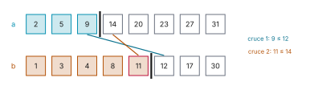

# Ejercicio 7

> 7. ★★★ Mediana de dos arreglos ordenados de largo $n$: el $n$-ésimo menor de los $2n$
>    elementos. Diseña un algoritmo $O(\log n)$, demuestra su correctitud y da la cota
>    de información. (C2, C3, C5)

## 1. Problema

Dados $a[0..n-1]$ y $b[0..n-1]$ ordenados, devolver el $n$-ésimo menor de los $2n$.
Modelo: comparaciones. Convenios: $a[-1] = b[-1] = -\infty$, $a[n] = b[n] = +\infty$.

## 2. Algoritmo

Los $n$ menores son los primeros `mid1` de `a` y los primeros $n -$ `mid1` de `b`. Con
`l1` $= a[$`mid1`$- 1]$, `r1` $= a[$`mid1`$]$, `l2` $= b[$`mid2`$- 1]$, `r2` $= b[$`mid2`$]$, el
corte es válido si `l1` $\le$ `r2` y `l2` $\le$ `r1`. Búsqueda binaria sobre `mid1` en
$[0, n]$: si es válido, devolver $\max($`l1`, `l2`$)$; si `l1` $>$ `r2`, `hi = mid1 - 1`;
si no, `lo = mid1 + 1`.

En [`codigo/ejercicio-07.py`](codigo/ejercicio-07.py):

```python
def mediana(a, b):
    """Devuelve el n-ésimo menor de a y b, ordenados y de largo n."""
    n = len(a)
    lo, hi = 0, n                         # invariante: todo corte válido está en [lo, hi]
    while lo <= hi:
        mid1 = (lo + hi) // 2             # cuántos tomo de a
        mid2 = n - mid1                   # cuántos tomo de b
        l1 = a[mid1 - 1] if mid1 > 0 else float('-inf')    # último tomado de a
        r1 = a[mid1]      if mid1 < n else float('inf')    # primero dejado en a
        l2 = b[mid2 - 1] if mid2 > 0 else float('-inf')    # último tomado de b
        r2 = b[mid2]      if mid2 < n else float('inf')    # primero dejado en b
        if l1 <= r2 and l2 <= r1:         # corte válido
            return max(l1, l2)
        if l1 > r2:
            hi = mid1 - 1                 # falla el cruce 1: sobran de a
        else:
            lo = mid1 + 1                 # falla el cruce 2: faltan de a
```

Ejemplo. $n = 8$, `a` $= [2, 5, 9, 14, 20, 23, 27, 31]$, `b` $= [1, 3, 4, 8, 11, 12, 17, 30]$;
los 8 menores son $1, 2, 3, 4, 5, 8, 9, 11$ y la respuesta es 11. Las vueltas del
algoritmo:

```python
def vueltas(a, b):
    # las mismas vueltas de mediana, devolviendo el estado de cada una
    n, lo, hi = len(a), 0, len(a)
    while lo <= hi:
        mid1 = (lo + hi) // 2
        mid2 = n - mid1
        l1 = a[mid1 - 1] if mid1 > 0 else -math.inf
        r1 = a[mid1] if mid1 < n else math.inf
        l2 = b[mid2 - 1] if mid2 > 0 else -math.inf
        r2 = b[mid2] if mid2 < n else math.inf
        valido = l1 <= r2 and l2 <= r1
        yield lo, hi, mid1, mid2, l1, r1, l2, r2
        if valido:
            return
        if l1 > r2:
            hi = mid1 - 1
        else:
            lo = mid1 + 1

a = [2, 5, 9, 14, 20, 23, 27, 31]
b = [1, 3, 4, 8, 11, 12, 17, 30]
print(f"{'lo':>2} {'hi':>2} {'Φ':>2} {'mid1':>4} {'mid2':>4}  {'l1, r1':>7}  {'l2, r2':>7}   qué hace")
for lo, hi, mid1, mid2, l1, r1, l2, r2 in vueltas(a, b):
    if l1 <= r2 and l2 <= r1:
        hace = f"return max({l1}, {l2}) = {max(l1, l2)}"
    elif l1 > r2:
        hace = f"{l1} > {r2}: hi = {mid1 - 1}"
    else:
        hace = f"{l2} > {r1}: lo = {mid1 + 1}"
    print(f"{lo:>2} {hi:>2} {hi - lo + 1:>2} {mid1:>4} {mid2:>4}  {f'{l1}, {r1}':>7}  {f'{l2}, {r2}':>7}   {hace}")
print(f"\nmediana(a, b) = {mediana(a, b)};  sorted(a + b)[n - 1] = {sorted(a + b)[len(a) - 1]}")
```

```text
lo hi  Φ mid1 mid2   l1, r1   l2, r2   qué hace
 0  8  9    4    4   14, 20    8, 11   14 > 11: hi = 3
 0  3  4    1    7     2, 5   17, 30   17 > 5: lo = 2
 2  3  2    2    6     5, 9   12, 17   12 > 9: lo = 3
 3  3  1    3    5    9, 14   11, 12   return max(9, 11) = 11

mediana(a, b) = 11;  sorted(a + b)[n - 1] = 11
```



*Figura 1. La última vuelta, `mid1 = 3`: lo tomado (en color) son los 8 menores, y el
mayor de ellos, 11, recuadrado en rojo, es la respuesta. Las barras negras son el corte, y
las dos líneas, los dos cruces.*

## 3. Correctitud

Si un corte es válido, todo lo tomado es $\le \max($`l1`, `l2`$) \le$ todo lo dejado (por
el orden y los dos cruces), así que $\max($`l1`, `l2`$)$ es el $n$-ésimo menor.
Invariante: al principio de cada vuelta, si un corte es válido, está en $[lo, hi]$.
Inicialización: $[0, n]$ contiene todos los cortes. Mantenimiento: con $lo \le hi$ se tiene
$lo \le$ `mid1` $\le hi$. Si el corte es válido, se devuelve el valor correcto. Si
`l1` $>$ `r2`, por el orden el cruce 1 falla en todo corte mayor, así que el válido está en
$[lo,$ `mid1` $- 1]$. Si no, falla el cruce 2, que por el orden falla en todo corte menor,
y el válido está en $[$`mid1` $+ 1, hi]$. Conclusión: siempre existe un corte válido (el
primero donde vale el cruce 2), así que por el invariante el rango nunca queda vacío, y el
ciclo solo termina devolviendo el $n$-ésimo menor.

## 4. Potencial

$\Phi = hi - lo + 1$: entero, $\ge 1$ al empezar cada vuelta, y baja estrictamente, a
`mid1` $- lo$ o a $hi -$ `mid1`. Termina. Como `mid1` es el del medio, baja a lo sumo a
$\lfloor \Phi/2 \rfloor$: a lo sumo $\lfloor \log_2 (n+1) \rfloor + 1$ vueltas,
$O(\log n)$ comparaciones.

Comprobado corriendo el algoritmo sobre 50 000 pares al azar con repetidos, vigilando el
invariante y el potencial en cada vuelta y comparando con `sorted(a + b)[n - 1]`:

```python
def cortes_validos(a, b):
    n = len(a)
    ext = lambda arr, i: -math.inf if i < 0 else math.inf if i >= n else arr[i]
    return [i for i in range(n + 1)
            if ext(a, i - 1) <= ext(b, n - i) and ext(b, n - i - 1) <= ext(a, i)]

random.seed(7)
pares = 0
for _ in range(50_000):
    n = random.randint(1, 20)
    a = sorted(random.randint(0, 9) for _ in range(n))       # valores pequeños: repetidos
    b = sorted(random.randint(0, 9) for _ in range(n))
    validos = cortes_validos(a, b)
    assert validos                                            # siempre hay un corte válido
    phi_antes, k = None, 0
    for lo, hi, *_ in vueltas(a, b):
        k += 1
        assert all(lo <= i <= hi for i in validos)            # invariante
        phi = hi - lo + 1
        assert phi >= 1 and (phi_antes is None or phi <= phi_antes // 2)   # potencial
        phi_antes = phi
    assert k <= math.floor(math.log2(n + 1)) + 1
    assert mediana(a, b) == sorted(a + b)[n - 1]
    pares += 1
print(f"{pares:,} pares al azar con repetidos, n de 1 a 20: 0 fallos")
print("invariante, Φ ≤ ⌊Φ/2⌋ y a lo sumo ⌊log2(n + 1)⌋ + 1 vueltas en todos")
```

```text
50,000 pares al azar con repetidos, n de 1 a 20: 0 fallos
invariante, Φ ≤ ⌊Φ/2⌋ y a lo sumo ⌊log2(n + 1)⌋ + 1 vueltas en todos
```

## 5. Cota de información

La salida es una posición, y hay $2n$. Para cada una hay una entrada con valores distintos
donde el $n$-ésimo menor está ahí, y dos de ellas con posiciones distintas no pueden
compartir hoja. Son $2n$ hojas en un árbol binario: al menos $\lceil \log_2 (2n) \rceil$
comparaciones (C5, §3).

Con $n = 3$, una entrada por posición:

```python
familia = [([3, 5, 6], [1, 2, 4], "a", 0), ([1, 3, 5], [2, 4, 6], "a", 1),
           ([1, 2, 3], [4, 5, 6], "a", 2), ([1, 2, 4], [3, 5, 6], "b", 0),
           ([2, 4, 6], [1, 3, 5], "b", 1), ([4, 5, 6], [1, 2, 3], "b", 2)]
n = 3
print(f"{'a':>10} {'b':>10}   3.º menor   valor")
for a, b, arreglo, k in familia:
    valor = (a if arreglo == "a" else b)[k]
    assert len(set(a + b)) == 2 * n and sorted(a + b)[n - 1] == valor   # valores distintos
    print(f"{str(a):>10} {str(b):>10}   {arreglo}[{k}]{valor:>10}")
posiciones = {(arreglo, k) for _, _, arreglo, k in familia}
print(f"{len(posiciones)} posiciones distintas = 2n; ⌈log2(2n)⌉ = {math.ceil(math.log2(2 * n))}")
```

```text
         a          b   3.º menor   valor
 [3, 5, 6]  [1, 2, 4]   a[0]         3
 [1, 3, 5]  [2, 4, 6]   a[1]         3
 [1, 2, 3]  [4, 5, 6]   a[2]         3
 [1, 2, 4]  [3, 5, 6]   b[0]         3
 [2, 4, 6]  [1, 3, 5]   b[1]         3
 [4, 5, 6]  [1, 2, 3]   b[2]         3
6 posiciones distintas = 2n; ⌈log2(2n)⌉ = 3
```

El valor es 3 en las seis, pero la posición cambia. Lo que se cuenta son posiciones.

## 6. Conclusión

El algoritmo es correcto y hace $O(\log n)$ comparaciones, que coincide en orden con la
cota: es óptimo salvo una constante en el modelo de comparaciones.
