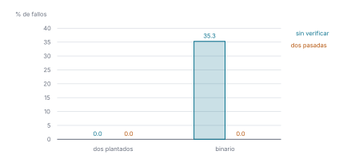

# Ejercicio 8

> 8. ★★ El elemento que aparece más de $n/3$ veces. Generaliza Boyer-Moore con dos
>    candidatos, enuncia el invariante reforzado y demuéstralo. Después escribe la
>    versión que devuelve los candidatos con contador positivo sin verificarlos, y
>    busca un generador de pruebas que no la atrape. Cuidado: el análogo del generador
>    binario de la conferencia 3 sí la atrapa. (C3)

## 1. Problema

Dado un arreglo $A$ de $n \ge 1$ elementos que solo se pueden comparar por igualdad,
devolver los elementos que aparecen más de $n/3$ veces. Hay a lo sumo dos: tres de ellos
ocuparían más de $n$ posiciones. Modelo: comparaciones de igualdad, con memoria extra
$O(1)$.

## 2. Algoritmo

Boyer-Moore con dos candidatos: recorrer el arreglo guardando dos candidatos con sus
contadores y cancelando tríos de elementos distintos; después, contar los candidatos. En
[`codigo/ejercicio-08.py`](codigo/ejercicio-08.py):

```python
def mayoria_tercio(A):
    candidato1, c1, candidato2, c2 = None, 0, None, 0
    for x in A:                      # primera pasada: cancelar
        if x == candidato1:
            c1 += 1
        elif x == candidato2:
            c2 += 1
        elif c1 == 0:
            candidato1, c1 = x, 1
        elif c2 == 0:
            candidato2, c2 = x, 1
        else:
            c1 -= 1
            c2 -= 1
    # segunda pasada: verificar
    return [m for m, c in ((candidato1, c1), (candidato2, c2))
            if c > 0 and 3 * A.count(m) > len(A)]
```

## 3. Correctitud

El invariante que uno escribe primero, *si un elemento aparece más de $i/3$ veces en
$A[1..i]$, es un candidato con contador positivo*, es verdadero pero no es inductivo: si
$A[1..i]$ no tiene un elemento así, no dice nada sobre los candidatos, y $A[1..i+1]$ puede
tenerlo (en `A B C A` pasa con $i = 3$). Se refuerza con la idea de cancelación.

- *Invariante:* después de procesar $A[1..i]$, el prefijo se puede partir en tríos de
  elementos distintos más $c_1$ copias del primer candidato y $c_2$ copias del segundo, y
  si hay segundo candidato, es distinto del primero.
- *Inicialización:* antes de la primera vuelta el prefijo es vacío y $c_1 = c_2 = 0$: cero
  tríos y cero copias. Todavía no hay segundo candidato.
- *Mantenimiento:* supongamos el invariante para $A[1..i]$ y procesemos $x = A[i+1]$. Hay
  cinco casos, uno por rama del `if`:
  1. Si $x$ es el primer candidato, $c_1$ sube en 1 y $x$ es una copia más. Los candidatos
     no cambian.
  2. Si $x$ es el segundo candidato, $c_2$ sube en 1 y $x$ es una copia más. Los candidatos
     no cambian.
  3. Si $x$ no es ningún candidato y $c_1 = 0$, no hay copias del primer candidato. El
     algoritmo hace primer candidato a $x$ con $c_1 = 1$, y la partición nueva es la misma
     más una copia de $x$. Como $x$ no es el segundo candidato, los dos siguen siendo
     distintos.
  4. Si $x$ no es ningún candidato, $c_1 > 0$ y $c_2 = 0$, no hay copias del segundo
     candidato. El algoritmo hace segundo candidato a $x$ con $c_2 = 1$, y la partición
     nueva es la misma más una copia de $x$. Como $x$ no es el primer candidato, los dos
     son distintos.
  5. Si $x$ no es ningún candidato y $c_1, c_2 > 0$, hay segundo candidato, y por el
     invariante es distinto del primero. Emparejamos $x$ con una de las $c_1$ copias del
     primer candidato y una de las $c_2$ copias del segundo: es un trío de elementos
     distintos, y quedan $c_1 - 1$ y $c_2 - 1$ copias, que es lo que el algoritmo deja en
     los contadores. Los candidatos no cambian.
- *Conclusión:* al terminar, $A$ entero se parte en $(n - c_1 - c_2)/3$ tríos de distintos,
  $c_1$ copias del primer candidato y $c_2$ copias del segundo. Supongamos que $m$ aparece
  más de $n/3$ veces y que no es un candidato con contador positivo. Entonces $m$ solo
  aparece en los tríos, y a lo sumo una vez por trío, porque los elementos de un trío son
  distintos. En total, a lo sumo $(n - c_1 - c_2)/3 \le n/3$ veces. Contradicción. Así que
  si un elemento aparece más de $n/3$ veces, es un candidato con contador positivo, y la
  segunda pasada, que cuenta los candidatos, devuelve exactamente los elementos que
  aparecen más de $n/3$ veces.

Comprobado con la primera pasada vigilada: después de cada elemento, quita del prefijo las
$c_1$ y $c_2$ copias y verifica que lo que queda se parte en tríos de distintos (lo que
pasa si y solo si su tamaño es múltiplo de 3 y nada aparece más de un tercio de las veces),
y que los candidatos son distintos:

```python
def se_parte_en_trios(S):
    # un multiconjunto se parte en tríos de distintos si y solo si su tamaño es
    # múltiplo de 3 y ningún elemento aparece más de un tercio de las veces
    return len(S) % 3 == 0 and all(3 * k <= len(S) for k in Counter(S).values())

def primera_pasada_vigilada(A):
    candidato1, c1, candidato2, c2 = None, 0, None, 0
    for i, x in enumerate(A):
        if x == candidato1:
            c1 += 1
        elif x == candidato2:
            c2 += 1
        elif c1 == 0:
            candidato1, c1 = x, 1
        elif c2 == 0:
            candidato2, c2 = x, 1
        else:
            c1 -= 1
            c2 -= 1
        resto = Counter(A[:i + 1])
        resto[candidato1] -= c1       # quitar las c1 copias del primer candidato
        resto[candidato2] -= c2       # y las c2 del segundo
        assert min(resto.values()) >= 0 and se_parte_en_trios(list(resto.elements()))
        assert c2 == 0 or candidato1 != candidato2
    return (candidato1, c1), (candidato2, c2)

random.seed(8)
prefijos = 0
for _ in range(3000):
    A = [random.choice("ABCDE") for _ in range(random.randint(1, 15))]
    primera_pasada_vigilada(A)
    prefijos += len(A)
print(f"invariante comprobado en {prefijos:,} prefijos, sin fallos")
```

```text
invariante comprobado en 23,840 prefijos, sin fallos
```

## 4. Versión sin verificar

La misma primera pasada, terminada sin contar:

```python
    return [m for m, c in ((candidato1, c1), (candidato2, c2)) if c > 0]
```

Por la conclusión, nunca deja fuera un elemento que aparece más de $n/3$ veces. Lo falso es
la recíproca: en `A A B`, `B` termina con contador 1 y aparece $1 = n/3$ veces.

Contra un oráculo que cuenta todo:

```python
def mayoria_tercio_sin_verificar(A):
    (candidato1, c1), (candidato2, c2) = primera_pasada_vigilada(A)
    return [m for m, c in ((candidato1, c1), (candidato2, c2)) if c > 0]

def oraculo(A):
    return [x for x, k in Counter(A).items() if 3 * k > len(A)]

A = list("AAB")
print(f"A A B: sin verificar {mayoria_tercio_sin_verificar(A)}, oráculo {oraculo(A)}")
```

```text
A A B: sin verificar ['A', 'B'], oráculo ['A']
```

## 5. Generador que no la atrapa

Plantar dos elementos distintos con $\lfloor n/3 \rfloor + 1$ copias cada uno y completar
al azar. Por la conclusión, los dos son candidatos con contador positivo; como solo hay
dos candidatos, la versión sin verificar devuelve exactamente esos dos, y los dos son
respuesta. El análogo del binario sí la atrapa: con dos símbolos nunca hay tres elementos
distintos, los contadores terminan siendo las dos cuentas, y se devuelven los dos símbolos
aunque uno no aparezca más de $n/3$ veces, como en `A A B`.

Medido con 4000 arreglos de largo hasta 15 por generador:

```python
def dos_plantados(n):         # el generador que no la atrapa
    p, q = random.sample("ABCDE", 2)
    k = n // 3 + 1
    A = [p] * k + [q] * k + [random.choice("ABCDE") for _ in range(n - 2 * k)]
    random.shuffle(A)
    return A

generadores = {
    "dos plantados": (dos_plantados, 4),            # necesita 2(⌊n/3⌋ + 1) <= n
    "binario": (lambda n: [random.choice("AB") for _ in range(n)], 1),
}

random.seed(5)
fallos = {}
print(f"{'generador':>14} {'sin verificar':>14} {'dos pasadas':>12}")
for nombre, (generar, minimo) in generadores.items():
    casos = [generar(random.randint(minimo, 15)) for _ in range(4000)]
    f_sin = sum(set(mayoria_tercio_sin_verificar(A)) != set(oraculo(A)) for A in casos)
    f_bm = sum(set(mayoria_tercio(A)) != set(oraculo(A)) for A in casos)
    fallos[nombre] = (100 * f_sin / len(casos), 100 * f_bm / len(casos))
    print(f"{nombre:>14} {fallos[nombre][0]:>13.1f}% {fallos[nombre][1]:>11.1f}%")
```

```text
     generador  sin verificar  dos pasadas
 dos plantados           0.0%         0.0%
       binario          35.3%         0.0%
```



*Figura 1. Porcentaje de arreglos en que cada versión se equivoca, según cómo se generaron
las pruebas. Con dos elementos plantados, la versión sin verificar es indistinguible de la
correcta; con el binario, no.*

## 6. Conclusión

El algoritmo es correcto, y la segunda pasada no se puede omitir.
