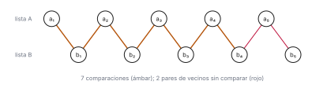

# Ejercicio 9

> 9. ★★ Una mezcla "optimizada" de dos listas ordenadas de largo $n$ deja de comparar
>    cuando a la primera lista le queda un solo elemento, y lo pone al final. Cuenta
>    cuántas comparaciones hace en el peor caso. Sin probarla, usa la sección 6 de la
>    conferencia 5 para decidir si es correcta, y construye con el adversario la entrada
>    en la que falla. (C5)

## 1. Problema

Dadas dos listas ordenadas $A = (a_1 < a_2 < \cdots < a_n)$ y $B = (b_1 < b_2 < \cdots < b_n)$,
con $n \ge 1$ y los $2n$ elementos distintos, devolver los $2n$ elementos en orden. Modelo:
comparaciones.

## 2. Algoritmo

La mezcla compara los primeros elementos que quedan en $A$ y en $B$ y pasa el menor a la
salida, mientras a $A$ le queden al menos dos elementos y $B$ no esté vacía. Si el ciclo
termina porque a $A$ le queda un solo elemento, pega lo que queda de $B$ y pone ese
elemento al final. Si termina porque $B$ se vació, pega lo que queda de $A$. En
[`codigo/ejercicio-09.py`](codigo/ejercicio-09.py):

```python
def mezcla_optimizada(A, B):
    R, i, j = [], 0, 0
    while len(A) - i > 1 and j < len(B):
        if A[i] <= B[j]:
            R.append(A[i]); i += 1
        else:
            R.append(B[j]); j += 1
    if len(A) - i == 1:
        return R + B[j:] + [A[i]]      # lo que queda de B, y a_n al final
    return R + A[i:]                   # B se vació
```

## 3. Costo

Cada comparación saca exactamente un elemento a la salida, así que el número de
comparaciones es el número de elementos que salen dentro del ciclo. Antes de cada
comparación se cumple la condición del ciclo: han salido a lo sumo $n - 2$ elementos de
$A$ y a lo sumo $n - 1$ de $B$. Antes de la última comparación han salido entonces a lo
sumo $2n - 3$ elementos, y esa comparación saca uno más. Por tanto el algoritmo hace a lo
sumo $2n - 2$ comparaciones en cualquier entrada.

La cota se alcanza. Con la entrada
$b_1 < a_1 < b_2 < a_2 < \cdots < b_{n-1} < a_{n-1} < a_n < b_n$, los elementos salen en ese
orden, uno por comparación, y el ciclo termina cuando sale $a_{n-1}$, porque a $A$ solo le
queda $a_n$. En ese momento han salido $2n - 2$ elementos. El peor caso es exactamente
$2n - 2$ comparaciones (con $n = 1$, ninguna).

Contado sobre todas las formas de repartir $1, \ldots, 2n$ entre las dos listas, para
$n \le 7$, y sobre la entrada de arriba:

```python
def mezcla_optimizada_contada(A, B):
    # la misma mezcla, guardando qué pares compara
    R, i, j, comparados = [], 0, 0, []
    while len(A) - i > 1 and j < len(B):
        comparados.append((A[i], B[j]))
        if A[i] <= B[j]:
            R.append(A[i]); i += 1
        else:
            R.append(B[j]); j += 1
    if len(A) - i == 1:
        return R + B[j:] + [A[i]], comparados
    return R + A[i:], comparados

print(f"{'n':>2} {'entradas':>9} {'peor caso medido':>17} {'2n - 2':>7}")
for n in range(1, 8):
    peor = 0
    for pos_a in combinations(range(2 * n), n):     # todas las formas de repartir 1..2n
        A = [v + 1 for v in pos_a]
        B = [v + 1 for v in range(2 * n) if v not in pos_a]
        R, comparados = mezcla_optimizada_contada(A, B)
        assert R == mezcla_optimizada(A, B)
        peor = max(peor, len(comparados))
    # la entrada de la sección 3: b1 < a1 < b2 < a2 < ... < b(n-1) < a(n-1) < a_n < b_n
    A = [2 * k for k in range(1, n)] + [2 * n - 1]
    B = [2 * k - 1 for k in range(1, n)] + [2 * n]
    assert len(mezcla_optimizada_contada(A, B)[1]) == peor == 2 * n - 2
    print(f"{n:>2} {len(list(combinations(range(2 * n), n))):>9} {peor:>17} {2 * n - 2:>7}")
```

```text
 n  entradas  peor caso medido  2n - 2
 1         2                 0       0
 2         6                 2       2
 3        20                 4       4
 4        70                 6       6
 5       252                 8       8
 6       924                10      10
 7      3432                12      12
```

## 4. Correctitud

El algoritmo solo accede a los elementos comparándolos, así que la cota mínima de la
conferencia 5, §6, se le aplica: todo algoritmo de comparaciones que mezcla correctamente
dos listas ordenadas de largo $n$ hace al menos $2n - 1$ comparaciones en el peor caso. Si
fuera correcto, haría al menos $2n - 1$ comparaciones en alguna entrada. Hace
a lo sumo $2n - 2$ en toda entrada. Por tanto no es correcto: hay una entrada en la que
devuelve una salida equivocada.

## 5. Contraejemplo

Si $n = 1$, el algoritmo no compara nada y devuelve $b_1, a_1$, que está mal cuando
$a_1 < b_1$. Sea entonces $n \ge 2$. El adversario contesta como en la conferencia 5, §6,
con la intercalada perfecta

$$I: \quad a_1 < b_1 < a_2 < b_2 < \cdots < a_n < b_n.$$

Con esas respuestas el algoritmo saca $a_1, b_1, a_2, b_2, \ldots, b_{n-2}, a_{n-1}$, uno por
comparación. En cuanto sale $a_{n-1}$, a $A$ le queda solo $a_n$ y el ciclo termina, sin
haber sacado $b_{n-1}$. Hizo $2n - 3$ comparaciones, todas entre vecinos de la cadena, y no
comparó los pares de vecinos $(b_{n-1}, a_n)$ ni $(a_n, b_n)$.



*Figura 1. La entrada del adversario con $n = 5$, con la lista $A$ arriba y la lista $B$
abajo, y las comparaciones que hace la mezcla optimizada al correr sobre ella. En rojo, los
pares de vecinos que no compara, $(b_4, a_5)$ y $(a_5, b_5)$.*

Sea $I'$ la entrada que resulta de intercambiar los valores de $a_n$ y $b_n$:

$$I': \quad a_1 < b_1 < \cdots < a_{n-1} < b_{n-1} < b_n < a_n.$$

Las dos listas siguen ordenadas, porque $a_n$ y $b_n$ son vecinos en la cadena y nada queda
entre ellos. Todas las comparaciones que el algoritmo hizo dan la misma respuesta en $I$ y
en $I'$, porque ninguna involucraba a los dos a la vez y el orden con el resto no cambió.
Entonces el algoritmo hace lo mismo con las dos entradas y devuelve en las dos

$$a_1, b_1, \ldots, a_{n-1}, b_{n-1}, b_n, a_n,$$

es decir, lo que salió en el ciclo, después lo que queda de $B$, y $a_n$ al final. Pero la
salida correcta cambió: en $I'$ es esa, y en $I$, donde $a_n < b_n$, termina en $a_n, b_n$.
El algoritmo da la misma salida para las dos entradas, así que se equivoca en una, y es en
$I$. Por ejemplo, con $n = 3$, $A = (1, 3, 5)$ y $B = (2, 4, 6)$, el algoritmo hace 3
comparaciones y devuelve $(1, 2, 3, 4, 6, 5)$.

Ejecutado sobre la entrada del adversario con $n = 5$ y sobre el ejemplo con $n = 3$:

```python
def intercalada(n):
    # a1 < b1 < a2 < b2 < ... < an < bn, con valores 1, 2, ..., 2n
    return [2 * k - 1 for k in range(1, n + 1)], [2 * k for k in range(1, n + 1)]

nombre = lambda v: f"a{(v + 1) // 2}" if v % 2 else f"b{v // 2}"
n = 5
A, B = intercalada(n)
R, comparados = mezcla_optimizada_contada(A, B)
vecinos = {(v, v + 1) for v in range(1, 2 * n)}
sin_comparar = vecinos - {tuple(sorted(p)) for p in comparados}
print(f"n = {n}: {len(comparados)} comparaciones (2n - 3 = {2 * n - 3})")
print("pares de vecinos sin comparar:",
      ", ".join(f"({nombre(x)}, {nombre(y)})" for x, y in sorted(sin_comparar)))
print("salida:  ", " ".join(nombre(v) for v in R))
print("correcta:", " ".join(nombre(v) for v in sorted(A + B)))

A, B = [1, 3, 5], [2, 4, 6]
R, comparados = mezcla_optimizada_contada(A, B)
print(f"\nA = {A}, B = {B}: {len(comparados)} comparaciones, devuelve {R}")
```

```text
n = 5: 7 comparaciones (2n - 3 = 7)
pares de vecinos sin comparar: (b4, a5), (a5, b5)
salida:   a1 b1 a2 b2 a3 b3 a4 b4 b5 a5
correcta: a1 b1 a2 b2 a3 b3 a4 b4 a5 b5

A = [1, 3, 5], B = [2, 4, 6]: 3 comparaciones, devuelve [1, 2, 3, 4, 6, 5]
```

## 6. Conclusión

La mezcla "optimizada" hace $2n - 2$ comparaciones en el peor caso, una menos que las
$2n - 1$ que necesita todo algoritmo de comparaciones correcto, y por eso no es correcta.
La comparación que se ahorra es la del par de vecinos $a_n, b_n$, y la entrada en la que
falla es la intercalada perfecta $a_1 < b_1 < \cdots < a_n < b_n$, donde pone $a_n$ después
de $b_n$.
