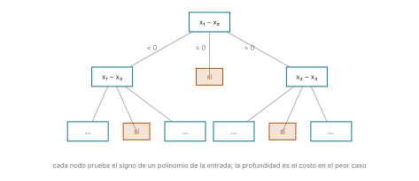
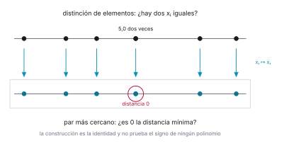
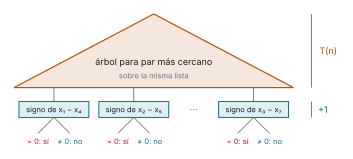
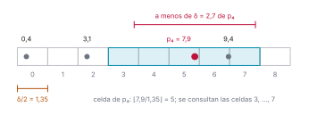

# Ejercicio 10

> 10. ★★ Par más cercano en una dimensión. Demuestra $\Omega(n \log n)$ en árboles de
>     decisión algebraicos por reducción desde distinción de elementos. Después di qué
>     algoritmo de la conferencia 2 rompe la cota, en qué modelo, y adáptalo a una
>     dimensión. (C2, C5)

## 1. Problema

*Par más cercano en una dimensión.* Dada una lista $X = (x_1, \ldots, x_n)$ de $n \ge 2$
números reales, encontrar dos posiciones distintas $i \ne j$ que minimizan $|x_i - x_j|$.
Llamamos $\delta(X)$ a esa distancia mínima.

- **Empates.** Si varios pares alcanzan el mínimo, devolvemos cualquiera.
- **Repetidos.** $X$ es una lista y admite valores repetidos. Si los hay, la respuesta es 0.

**Distinción de elementos.** Dados $n$ reales $x_1, \ldots, x_n$, decidir si hay dos iguales.

## 2. La cota mínima

**Modelo.** Un **árbol de decisión algebraico** es un árbol donde cada nodo interno evalúa
el signo de un polinomio de grado acotado en los números de la entrada y ramifica según sea
negativo, cero o positivo, y cada hoja da una respuesta. El costo es la profundidad del
árbol, o sea el número de pruebas en el peor caso. Comparar dos números de la entrada es la
prueba de signo de $x_i - x_j$, un polinomio de grado 1.



*Figura 1. Un árbol de decisión algebraico para distinción de elementos. Cada nodo prueba
el signo de un polinomio de la entrada y ramifica en tres; las hojas «sí» responden que hay
dos iguales. La profundidad es el costo en el peor caso.*

Ahora el resultado que usamos, y que no demostramos.

**Teorema (Ben-Or, 1983).** Distinción de elementos requiere $\Omega(n \log n)$ en el modelo
de árboles de decisión algebraicos.

Lo que demostramos es que el par más cercano en una dimensión hereda esa cota.

**Lema.** Para toda lista $X$, $\delta(X) = 0$ si y solo si dos de los $x_i$ son iguales.

*Demostración.* Si $x_i = x_j$ con $i \ne j$, ese par está a distancia $|x_i - x_j| = 0$, y
ninguna distancia es negativa, así que $\delta(X) = 0$. Recíprocamente, si $\delta(X) = 0$,
el mínimo lo alcanza algún par $i \ne j$ con $|x_i - x_j| = 0$, es decir, $x_i = x_j$.
$\square$

**Teorema.** Par más cercano en una dimensión requiere $\Omega(n \log n)$ en árboles de
decisión algebraicos.

*Demostración.* Por reducción desde distinción de elementos. Dada una entrada
$x_1, \ldots, x_n$ de distinción de elementos, construimos la entrada de par más cercano

$$X = (x_1, x_2, \ldots, x_n),$$

la misma lista. Es una entrada válida porque el problema admite repetidos, y construirla no
usa ninguna prueba de signo. Eso importa: para que la cota pase de un problema al otro, la
construcción tiene que costar menos que la cota, y aquí no cuesta nada. Por el lema, la
distancia del par más cercano de $X$ es 0 si y solo si dos de los $x_i$ son iguales.

Supongamos que existiera un algoritmo para par más cercano en una dimensión con
profundidad $T(n) = o(n \log n)$. Componiéndolo con la construcción y con una prueba final
de si el resultado es 0 —el signo de $x_i - x_j$ sobre el par $(i, j)$ que devuelve—,
tendríamos un algoritmo para distinción de elementos de profundidad
$T(n) + 1 = o(n \log n)$, contra el teorema de Ben-Or. $\square$



*Figura 2. La reducción en una dimensión: los $n$ reales son ya $n$ puntos de la recta. Dos
valores iguales son dos puntos a distancia 0, así que la respuesta de un problema es la
respuesta del otro.*



*Figura 3. La composición. Cada hoja del árbol para par más cercano devuelve un par
$(i, j)$, y debajo se cuelga una prueba de signo más. El resultado es un árbol para
distinción de elementos de profundidad $T(n) + 1$.*

## 3. El algoritmo que rompe la cota, y en qué modelo

**El algoritmo.** Es el **incremental aleatorio con rejilla**. Permutamos los puntos al
azar, $p_1, p_2, \ldots, p_n$, y los insertamos uno por uno, manteniendo en todo momento
$\delta$, la distancia del par más cercano entre los ya insertados. Los guardamos en una
rejilla de celdas cuadradas de lado $\delta/2$, donde la celda de un punto $q$ es
$(\lfloor q_x/(\delta/2) \rfloor, \lfloor q_y/(\delta/2) \rfloor)$, en una tabla hash. Cada
celda tiene a lo sumo un punto, porque su diagonal mide $\frac{\delta}{2}\sqrt{2} < \delta$.
Al insertar $p_{i+1}$ basta consultar el bloque de $5 \times 5$ celdas centrado en la suya;
si $\delta$ baja, se reconstruye la rejilla con el nuevo lado, en $O(i)$. El análisis hacia
atrás da probabilidad a lo sumo $2/(i+1)$ de reconstruir en el paso $i + 1$, y el tiempo
esperado es $O(n)$.

**El modelo.** La RAM con números reales, ampliada con tres operaciones de costo constante:
la parte entera $\lfloor \cdot \rfloor$, el acceso a una tabla hash y la elección al azar.
No es un árbol de decisión algebraico:

- Calcula $\lfloor q_x/(\delta/2) \rfloor$, que es lo que convierte un punto en su celda. La
  parte entera no es un polinomio, ni es continua. Un árbol de decisión algebraico no puede
  evaluarla.
- Usa el resultado como dirección: va a buscar a la tabla hash la celda cuyo índice acaba
  de calcular. Un árbol de decisión no tiene direccionamiento indirecto; su única operación
  es ramificar según el signo de un polinomio de la entrada.

## 4. El algoritmo en una dimensión

Permutamos los números al azar: $p_1, p_2, \ldots, p_n$. Los insertamos uno por uno,
manteniendo en todo momento $\delta$, la distancia del par más cercano entre los ya
insertados. La estructura es una rejilla de celdas de largo $\delta/2$ sobre la recta, donde
la celda de un número $q$ es

$$\left\lfloor \frac{q}{\delta/2} \right\rfloor,$$

el índice del intervalo $[k\frac{\delta}{2}, (k+1)\frac{\delta}{2})$ que contiene a $q$,
guardada en una tabla hash. Respecto al plano cambian tres cosas: la celda tiene una
coordenada en lugar de dos, el bloque de $5 \times 5$ celdas se vuelve un tramo de 5 celdas,
y la distancia es $|p - q|$. Además, como la lista admite repetidos, $\delta$ puede llegar a
0; en ese momento la respuesta ya es 0, que ninguna distancia mejora, y el algoritmo se
detiene. Así la rejilla siempre tiene largo $\delta/2 > 0$.

```python
def par_mas_cercano_1d_aleatorio(X, semilla=0):
    pts = list(X)
    random.Random(semilla).shuffle(pts)
    d, par = abs(pts[0] - pts[1]), (pts[0], pts[1])
    if d == 0:                                 # repetidos: la respuesta es 0
        return 0, par
    lado = d / 2
    celda = lambda q: int(q // lado)
    rejilla = {celda(q): q for q in pts[:2]}
    for i in range(2, len(pts)):
        p = pts[i]
        antes, c = d, celda(p)
        for dc in (-2, -1, 0, 1, 2):           # las 5 celdas vecinas
            q = rejilla.get(c + dc)
            if q is not None and abs(p - q) < d:
                d, par = abs(p - q), (p, q)
        if d == 0:                             # p repite un valor
            return 0, par
        if d < antes:                          # delta bajó: reconstruir
            lado = d / 2                       # `celda` lee el nuevo lado
            rejilla = {celda(q): q for q in pts[:i + 1]}
        else:
            rejilla[c] = p
    return d, par
```

En [`codigo/ejercicio-10.py`](codigo/ejercicio-10.py), comprobado contra la fuerza bruta,
que ordena y mira los pares consecutivos:

```python
random.seed(11)
casos, fallos = 0, 0
for _ in range(20_000):
    n = random.randint(2, 40)
    if random.random() < 0.5:
        X = [random.uniform(-100, 100) for _ in range(n)]          # sin repetidos
    else:
        X = [random.randint(0, 60) for _ in range(n)]              # con repetidos
    d, (p, q) = par_mas_cercano_1d_aleatorio(X, semilla=casos)
    fallos += d != delta(X) or abs(p - q) != d
    casos += 1
print(f"{casos:,} listas de 2 a 40 números, con y sin repetidos:"
      f" {fallos} fallos contra la fuerza bruta")
```

```text
20,000 listas de 2 a 40 números, con y sin repetidos: 0 fallos contra la fuerza bruta
```

**Invariante.** Cada celda contiene a lo sumo un punto.

*Demostración.* Dos puntos en la misma celda están a distancia menor que su largo,
$\frac{\delta}{2} < \delta$, y $\delta$ es la mínima distancia entre los puntos insertados.
$\square$

**Inserción de $p_{i+1}$.** Cualquier punto $q$ a distancia menor que $\delta$ de $p_{i+1}$
difiere de él en menos de $\delta = 2 \cdot (\delta/2)$, o sea en menos de dos celdas. En
efecto, con $a = p_{i+1}/(\delta/2)$ y $b = q/(\delta/2)$ se tiene $|a - b| < 2$; si
$a \le b$, entonces $\lfloor b \rfloor \le b < a + 2 < \lfloor a \rfloor + 3$, y como son
enteros, $\lfloor b \rfloor - \lfloor a \rfloor \le 2$ (el otro caso es simétrico). Está
entonces en el tramo de 5 celdas $c - 2, \ldots, c + 2$ centrado en la celda $c$ de
$p_{i+1}$. Consultamos esas 5 celdas, cada una con a lo sumo un punto por el invariante: 5
accesos a la tabla hash, $O(1)$.

- Si no hay ninguno más cerca que $\delta$, entonces $\delta$ no cambia. Insertamos
  $p_{i+1}$ en su celda y seguimos. Costo $O(1)$.
- Si lo hay, $\delta$ baja a un $\delta'$ nuevo, la rejilla vieja ya no sirve y hay que
  reconstruirla entera con largo $\delta'/2$. Costo $O(i)$.
- Si $\delta' = 0$, $p_{i+1}$ repite un valor ya insertado: la respuesta es 0 y el algoritmo
  se detiene.



*Figura 4. La rejilla real de $p_1, \ldots, p_8 = 3{,}1;\ 9{,}4;\ 0{,}4;\ 7{,}9;\ 5{,}2;\ 1{,}0;\ 12{,}6;\ 6{,}0$
justo antes de insertar $p_4$. Con $p_1, p_2, p_3$ insertados,
$\delta = |3{,}1 - 0{,}4| = 2{,}7$. Un punto por celda; lo que está a menos de $\delta$ de
$p_4$ cae en el tramo de 5 celdas. Ahí está 9,4, a $1{,}5 < 2{,}7$: $\delta$ baja y la
rejilla se reconstruye con largo 0,75.*

## 5. Conclusión

Par más cercano en una dimensión requiere $\Omega(n \log n)$ en árboles de decisión
algebraicos. En la RAM con parte entera, tabla hash y azar, la rejilla adaptada a la recta
lo resuelve en tiempo esperado $O(n)$. No hay contradicción: son dos modelos distintos.
