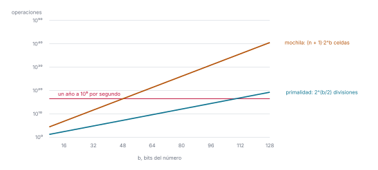

# Ejercicio 11

> 11. ★★ La mochila entera se resuelve con programación dinámica en $O(nW)$, donde $W$ es
>     la capacidad (lo vieron en Estructuras de Datos). Mide el tamaño de la entrada en
>     bits, como en la sección 8 de la conferencia 1. ¿Es polinomial ese algoritmo? ¿En
>     qué se parece a la primalidad por división? (C1)

## 1. El algoritmo

Hay $n$ objetos, el objeto $i$ pesa $w_i$ y vale $v_i$, y la mochila aguanta un peso $W$.
Hay que escoger objetos de peso total a lo sumo $W$ con el mayor valor total. El algoritmo
de programación dinámica llena una tabla $c$ de $n + 1$ filas y $W + 1$ columnas, donde
$c[i][x]$ es el mayor valor que se consigue con los objetos $1, \ldots, i$ y una mochila de
capacidad $x$. La fila 0 y la columna 0 valen 0, porque sin objetos o sin capacidad no se
lleva nada. Para llenar $c[i][x]$ se mira el objeto $i$. Si no cabe, $w_i > x$, queda lo
mismo que sin él, $c[i-1][x]$. Si cabe, hay dos opciones, no tomarlo y quedarse con
$c[i-1][x]$, o tomarlo y sumar $v_i$ a lo mejor que se consigue con los objetos anteriores
en la capacidad que sobra, $c[i-1][x - w_i]$; la celda guarda la mayor. La respuesta es
$c[n][W]$. El código, en [`codigo/ejercicio-11.py`](codigo/ejercicio-11.py), cuenta las
celdas que calcula:

```python
def mochila(v, w, n, W):
    celdas = 0
    c = [[0] * (W + 1) for _ in range(n + 1)]       # fila 0 y columna 0 valen 0
    for i in range(1, n + 1):
        for x in range(1, W + 1):
            celdas += 1
            if w[i - 1] <= x:
                if v[i - 1] + c[i - 1][x - w[i - 1]] > c[i - 1][x]:
                    c[i][x] = v[i - 1] + c[i - 1][x - w[i - 1]]
                else:
                    c[i][x] = c[i - 1][x]
            else:
                c[i][x] = c[i - 1][x]
    return c[n][W], celdas

v, w = [4, 6, 9], [3, 5, 7]
for W in [100, 10_000, 1_000_000]:
    optimo, celdas = mochila(v, w, 3, W)
    print(f"W = {W:>9,}   óptimo: {optimo}   celdas: {celdas:>9,}")
```

```text
W =       100   óptimo: 19   celdas:       300
W =    10,000   óptimo: 19   celdas:    30,000
W = 1,000,000   óptimo: 19   celdas: 3,000,000
```

Cada celda cuesta unas pocas operaciones, así que el costo es el número de celdas por una
constante. El algoritmo calcula siempre las $n \cdot W$ celdas, sin saltarse ninguna y sin
importar cuánto pesen o valgan los objetos: en la salida de arriba el óptimo es 19 en los
tres casos, y el trabajo se multiplica por 10 000. Para $n$ objetos hace unas $nW$
operaciones. Crece linealmente con $W$, así que parece un buen algoritmo.

## 2. El tamaño de la entrada

El costo $O(nW)$ está medido en función de $W$, pero $W$ es el valor de un número de la
entrada, no su tamaño. La entrada son los $n$ pesos, los $n$ valores y la capacidad $W$, y
un algoritmo se mide en función del tamaño de su entrada, porque eso es lo que ocupa en
memoria y lo que hay que leer. Para escribir $W$ en binario hacen falta
$b = \lfloor \log_2 W \rfloor + 1$ bits, y lo mismo para cada peso y cada valor. Los pesos y
los valores ocupan los mismos bits sea cual sea $W$, así que, con ellos fijos, lo que crece
con la capacidad son los $b$ bits de $W$.

## 3. ¿Es polinomial?

La tabla tiene $(n+1)(W+1)$ celdas. Con $b$ bits, $W$ puede valer hasta $2^b - 1$, así que
en función de $b$ las $W + 1$ columnas son $2^b$ y la tabla tiene $(n+1) \cdot 2^b$ celdas.
El algoritmo es exponencial en el tamaño de la entrada. Con $n = 100$ objetos y $10^9$
celdas por segundo (el mismo cálculo que la conferencia 1, §8, hace para las divisiones de
la primalidad):

```python
segundos_por_año = 3600 * 24 * 365
n = 100

for bits in [16, 32, 64, 128, 256]:
    celdas = (n + 1) * 2 ** bits
    segundos = celdas / 10**9
    if segundos < 60:
        tiempo = f"{segundos:.3g} segundos"
    elif segundos < 3600:
        tiempo = f"{segundos / 60:.3g} minutos"
    else:
        tiempo = f"{segundos / segundos_por_año:.3g} años"
    print(f"{bits:>5} bits   {float(celdas):>9.3g} celdas   {tiempo}")
```

```text
   16 bits    6.62e+06 celdas   0.00662 segundos
   32 bits    4.34e+11 celdas   7.23 minutos
   64 bits    1.86e+21 celdas   5.91e+04 años
  128 bits    3.44e+40 celdas   1.09e+24 años
  256 bits    1.17e+79 celdas   3.71e+62 años
```

No es polinomial: un algoritmo es polinomial si su costo es polinomial en el tamaño de la
entrada, y este cuesta $(n+1) \cdot 2^b$. Su costo es polinomial en el valor de $W$ pero no
en su cantidad de bits: es pseudopolinomial.

## 4. ¿En qué se parece a la primalidad por división?

La primalidad por división prueba los divisores desde 2 hasta $\sqrt{n}$, y para $n$ primo
hace unas $\sqrt{n}$ divisiones. Para escribir $n$ hacen falta
$b = \lfloor \log_2 n \rfloor + 1$ bits, y en función de $b$ las $\sqrt{n}$ divisiones son
$\sqrt{2^b} = 2^{b/2}$.

Con la función `es_primo` de la conferencia 1, §1, sobre el mayor primo de $b$ bits:

```python
def es_primo(n):
    divisiones = 0
    d = 2
    while d * d <= n:
        divisiones += 1
        if n % d == 0:
            return False, divisiones
        d += 1
    return n >= 2, divisiones

def primo_de(b):
    # el mayor primo de b bits
    p = 2 ** b - 1
    while not es_primo(p)[0]:
        p -= 1
    return p

print(f"{'b':>3} {'primo de b bits':>16} {'divisiones':>11} {'2^(b/2)':>9}")
for b in [10, 20, 30, 40]:
    p = primo_de(b)
    _, divisiones = es_primo(p)
    print(f"{b:>3} {p:>16,} {divisiones:>11,} {2 ** (b / 2):>9,.0f}")
for W in [100, 10_000, 1_000_000]:
    b = W.bit_length()
    assert mochila(v, w, 3, W)[1] == 3 * W and W < 2 ** b    # n·W celdas, W < 2^b
```

```text
  b  primo de b bits  divisiones   2^(b/2)
 10            1,021          30        32
 20        1,048,573       1,022     1,024
 30    1,073,741,789      32,766    32,768
 40 1,099,511,627,689   1,048,574 1,048,576
```

Los dos algoritmos se parecen en lo mismo: su costo se midió en función del valor de un
número de la entrada, $n$ en la primalidad y $W$ en la mochila, y no en función de su
tamaño. Por eso los dos parecen eficientes, un solo ciclo hasta $\sqrt{n}$ o una tabla de
$O(nW)$, y medidos en bits los dos son exponenciales: $2^{b/2}$ divisiones y
$(n+1) \cdot 2^b$ celdas. Los dos son polinomiales en el valor de un número de la entrada y
no en su cantidad de bits: los dos son pseudopolinomiales.



*Figura 1. Las operaciones de los dos algoritmos en función de los bits $b$ del número, en
escala logarítmica, con $n = 100$ objetos en la mochila. Las dos son rectas, es decir,
exponenciales en $b$; la de la mochila tiene el doble de pendiente. La línea roja es lo que
se hace en un año a $10^9$ operaciones por segundo.*
