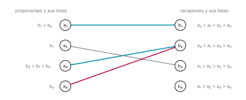

# Ejercicio 12

> 12. ★★★ Gale-Shapley con listas incompletas: cada proponente lista solo a algunos
>     receptores, y prefiere quedarse solo antes que con uno que no listó. Adapta el
>     algoritmo, su potencial y la definición de pareja bloqueante. ¿Sigue siendo
>     estable el resultado? Demuéstralo. (C3)

## 1. El problema

**Emparejamiento estable con listas incompletas.** Hay $n$ proponentes $a_1, \ldots, a_n$ y
$n$ receptores $b_1, \ldots, b_n$. Cada receptor tiene una lista de preferencias estricta y
completa sobre todos los proponentes. Cada proponente tiene una lista de preferencias
estricta sobre algunos receptores, y prefiere quedarse solo antes que con un receptor que no
está en su lista. Un receptor prefiere a cualquier proponente antes que quedarse solo.

Un emparejamiento $M$ empareja a algunos proponentes con receptores distintos, cada uno con
un receptor de su lista. Los demás se quedan solos. Si $a$ tiene pareja en $M$, esa pareja es
$M(a)$, y lo mismo para $M(b)$. Ya no se puede pedir que $M$ sea perfecto: si $a_1$ y $a_2$
solo listan a $b_1$, en cualquier emparejamiento uno de los dos se queda solo.

**Pareja bloqueante.** $M$ es inestable si hay un proponente $a$ y un receptor $b$, no
emparejados entre sí, tales que $b$ está en la lista de $a$, $a$ prefiere $b$ a su situación
en $M$, y $b$ prefiere $a$ a su situación en $M$. La situación de alguien en $M$ es su
pareja, o quedarse solo si no la tiene. A ese par se le llama pareja bloqueante: los dos
ganarían dejando su situación y yéndose juntos. Buscamos un emparejamiento sin parejas
bloqueantes.

La definición cambia en dos cosas respecto a listas completas. La situación de $a$ o de $b$
puede ser estar solo, así que hay parejas bloqueantes en las que uno de los dos, o los dos,
están solos. Y se exige que $b$ esté en la lista de $a$: si no está, $a$ prefiere quedarse
solo antes que estar con $b$, y el par no bloquea aunque los dos estén solos.

La figura 1 muestra una instancia de $4 \times 4$ con un emparejamiento inestable. Su pareja
bloqueante es de las nuevas: uno de los dos está solo.



*Figura 1. Un emparejamiento inestable, en azul: $a_1$–$b_1$ y $a_3$–$b_2$. Tiene una sola
pareja bloqueante, en rojo: $a_4$ está solo, $b_2$ está en su lista, y $b_2$ prefiere $a_4$
a $a_3$. El par gris no bloquea: $a_2$ y $b_3$ están solos, pero $b_3$ no está en la lista
de $a_2$.*

## 2. El algoritmo y su terminación

La idea sigue siendo la aceptación diferida. Los proponentes proponen en orden, de su
favorito hacia abajo. Un receptor nunca dice que sí de forma definitiva: se queda con la
mejor propuesta que ha recibido hasta ahora y la cambia si llega una mejor. Lo nuevo es qué
hacer con un proponente que se queda sin lista.

> Mientras haya un proponente libre al que le quede alguien en su lista, ese proponente le
> propone al mejor receptor de su lista al que todavía no le ha propuesto. Si el receptor
> está libre, acepta. Si ya tiene pareja y prefiere al nuevo, lo acepta y su pareja anterior
> queda libre. Si no, lo rechaza. Un proponente que queda libre después de proponerle a toda
> su lista se queda solo.

La regla nueva hace falta. Con listas completas, un proponente libre siempre tenía a quién
proponer. Ahora no: si $a_2$ solo lista a $b_1$ y $b_1$ lo rechaza, $a_2$ queda libre sin
nadie a quien proponer.

El algoritmo sigue siendo no determinista: no dice cuál proponente libre actúa primero, y
todo lo que demostremos tiene que valer para cualquier elección. En el código, en
[`codigo/ejercicio-12.py`](codigo/ejercicio-12.py), la cola `libres` guarda solo a los
proponentes libres a los que les queda lista. Las líneas que cambian respecto a la versión
con listas completas están marcadas con `# nuevo`.

```python
def gale_shapley(pref_a, pref_b, orden="cola", semilla=0, traza=None):
    n = len(pref_a)
    rango = [[0] * n for _ in range(n)]           # rango[b][a]: lugar de a en la lista de b
    for b in range(n):
        for lugar, a in enumerate(pref_b[b]):
            rango[b][a] = lugar
    siguiente = [0] * n                           # a qué lugar de su lista va a proponer a
    pareja_de_b = [None] * n
    libres = deque(a for a in range(n) if pref_a[a])                  # nuevo
    azar = random.Random(semilla)
    propuestas = 0

    while libres:
        if orden == "azar":
            libres.rotate(azar.randrange(len(libres)))
        a = libres.popleft() if orden == "cola" else libres.pop()
        b = pref_a[a][siguiente[a]]
        siguiente[a] += 1
        propuestas += 1
        actual = pareja_de_b[b]
        suelto = None                                                 # nuevo
        if actual is None:
            pareja_de_b[b] = a
        elif rango[b][a] < rango[b][actual]:
            pareja_de_b[b] = a
            suelto = actual                                           # nuevo
        else:
            suelto = a                                                # nuevo
        if suelto is not None and siguiente[suelto] < len(pref_a[suelto]):   # nuevo
            libres.append(suelto)                                     # nuevo
        if traza is not None:
            traza.append((a, b, actual, pareja_de_b[b]))

    M = [None] * n                                # M[a] = None: a se queda solo
    for b, a in enumerate(pareja_de_b):
        if a is not None:                                             # nuevo
            M[a] = b
    return M, propuestas
```

La instancia de la figura 1 con la estrategia de cola:

| paso | proponente | receptor | tenía | se queda con | qué pasa |
|---|---|---|---|---|---|
| 1 | a₁ | b₁ | — | a₁ | acepta |
| 2 | a₂ | b₁ | a₁ | a₁ | rechaza a a₂; a₂ se queda solo |
| 3 | a₃ | b₂ | — | a₃ | acepta |
| 4 | a₄ | b₂ | a₃ | a₄ | cambia; a₃ queda libre |
| 5 | a₃ | b₁ | a₁ | a₃ | cambia; a₁ queda libre |
| 6 | a₁ | b₂ | a₄ | a₄ | rechaza a a₁; a₁ se queda solo |

Resultado: a₃–b₁, a₄–b₂; a₁ y a₂ se quedan solos, en 6 propuestas.

Fíjate en tres cosas que la tabla deja ver. Las dos primeras son las mismas que con listas
completas, y la tercera es la nueva.

- Un receptor, una vez comprometido, no vuelve a quedar libre, y su pareja solo mejora. Solo
  cambia de pareja si llega alguien que prefiere. Mira la columna «se queda con» para $b_1$ y
  para $b_2$: siempre sube en su lista.
- Un proponente propone en orden decreciente de preferencia, y solo a receptores de su
  lista, así que sus parejas solo empeoran. Cada vez que queda libre, sigue desde donde
  estaba en su lista. $a_1$ empieza con su favorito y termina solo.
- Un proponente libre que no está en la cola ya le propuso a toda su lista. El código solo
  lo vuelve a meter en la cola si `siguiente[a]` es menor que el largo de su lista. Mira
  $a_2$ en el paso 2 y $a_1$ en el paso 6. En particular, todo proponente que termina solo le
  propuso a toda su lista.

Los tres son invariantes de una línea, y su demostración es leer el código.

**Terminación, por potencial.** Sea $\Phi$ el número de pares $(a, b)$ tales que $b$ está en
la lista de $a$ y $a$ todavía no le ha propuesto a $b$. Al principio $\Phi$ es la suma de los
largos de las listas de los proponentes, que es a lo sumo $n^2$. Cada vuelta del ciclo es
exactamente una propuesta, que nunca se repite porque `siguiente[a]` solo avanza, así que
$\Phi$ baja en 1. Y $\Phi \ge 0$ siempre. El ciclo termina después de a lo sumo tantas
vueltas como la suma de los largos de las listas.

El potencial es el de listas completas, contando solo los pares en que $b$ está en la lista
de $a$. En la traza empieza en $2 + 1 + 3 + 1 = 7$ y termina en 1: $a_3$ nunca necesitó
proponerle a $b_3$. Si todas las listas son completas, empieza en $n^2$ como antes.

Falta ver que `siguiente[a]` nunca se sale de la lista, es decir, que ningún proponente
propone después de proponerle a toda su lista. Con listas completas eso salía de que el
algoritmo termina con un emparejamiento perfecto, y ese argumento ya no vale: en la traza,
$a_2$ queda libre en el paso 2 después de proponerle a toda su lista. Ahora lo garantiza la
regla nueva. Un proponente entra en `libres` solo si `siguiente[a]` es menor que el largo de
su lista, y `siguiente[a]` solo cambia cuando $a$ sale de la cola. Así que todo proponente
que sale de la cola tiene a quién proponer.

## 3. Estabilidad

**Teorema.** El emparejamiento que devuelve Gale-Shapley con listas incompletas es estable,
para cualquier orden de ejecución.

*Demostración.* Por contradicción. Sea $M$ el resultado y supongamos que $(a, b)$ es una
pareja bloqueante: $b$ está en la lista de $a$, $a$ prefiere $b$ a su situación en $M$, y $b$
prefiere $a$ a su situación en $M$.

Primero, $a$ le propuso a $b$. Si $a$ terminó con $M(a)$, como propone en orden decreciente y
prefiere $b$ a $M(a)$, le propuso a $b$ antes que a $M(a)$. Si $a$ terminó solo, por el
tercer invariante le propuso a toda su lista, y $b$ está en ella.

En algún momento $b$ rechazó a $a$, al recibir la propuesta o más tarde, a cambio de alguien
que prefería. En particular $b$ estaba comprometido en ese momento, así que por el primer
invariante no terminó solo. Por el mismo invariante, la pareja de $b$ solo mejora a partir de
ahí, así que $b$ prefiere $M(b)$ a $a$. Contradicción con que $(a, b)$ bloquea. $\square$

La demostración es la de listas completas con un caso más: $a$ solo, que lo cubre el tercer
invariante. El caso en que $b$ está solo no puede darse, por el primero.

Comprobémoslo con un verificador de estabilidad por fuerza bruta, que ahora mira solo los
pares en que $b$ está en la lista de $a$, y con instancias donde cada proponente lista un
número al azar de receptores, entre 0 y $n$.

```python
def pares_bloqueantes(M, pref_a, pref_b):
    pareja_de_b = {b: a for a, b in enumerate(M) if b is not None}
    return [(a, b) for a in range(len(M)) for b in pref_a[a]
            if b != M[a]
            and (M[a] is None or pref_a[a].index(b) < pref_a[a].index(M[a]))
            and (b not in pareja_de_b
                 or pref_b[b].index(a) < pref_b[b].index(pareja_de_b[b]))]
```

```python
def instancia(n, rng):
    return ([rng.sample(range(n), rng.randint(0, n)) for _ in range(n)],
            [rng.sample(range(n), n) for _ in range(n)])

rng = random.Random(8)
print(f"{'n':>3} {'instancias':>11} {'bloqueantes':>12} {'propuestas':>11} {'suma de listas':>15}")
for n, veces in [(5, 400), (20, 100), (60, 20)]:
    bloqueantes, propuestas, cota = 0, 0, 0
    for _ in range(veces):
        pref_a, pref_b = instancia(n, rng)
        for orden in ("cola", "pila", "azar"):              # para cualquier orden
            assert not pares_bloqueantes(gale_shapley(pref_a, pref_b, orden, n)[0],
                                         pref_a, pref_b)
        M, k = gale_shapley(pref_a, pref_b, orden="azar", semilla=n)
        bloqueantes += len(pares_bloqueantes(M, pref_a, pref_b))
        assert k <= sum(len(lista) for lista in pref_a)   # la cota del potencial
        propuestas += k
        cota += sum(len(lista) for lista in pref_a)
    print(f"{n:>3} {veces:>11} {bloqueantes:>12} {propuestas / veces:>11.1f} {cota / veces:>15.1f}")
```

```text
  n  instancias  bloqueantes  propuestas  suma de listas
  5         400            0         5.8            12.4
 20         100            0        39.7           199.8
 60          20            0       177.7          1784.0
```

Ninguna pareja bloqueante en más de quinientas instancias, que es lo que el teorema predice.
La última columna es la cota del potencial, y la penúltima es lo que pasa en instancias
aleatorias: muy por debajo. La cota es de peor caso.

## 4. Conclusión

Sí, el resultado sigue siendo estable.

- **Algoritmo:** el mismo, salvo que un proponente que queda libre después de proponerle a
  toda su lista se queda solo.
- **Potencial:** el número de pares $(a, b)$ con $b$ en la lista de $a$ a los que $a$ todavía
  no les ha propuesto. Empieza en la suma de los largos de las listas y baja en 1 por vuelta.
- **Pareja bloqueante:** $b$ está en la lista de $a$, y cada uno prefiere al otro a su
  situación en $M$, que puede ser estar solo.
- **Estabilidad:** la demostración de listas completas, más el caso del proponente que
  termina solo.
