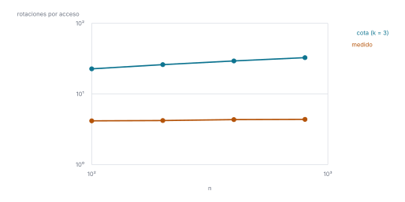

# Ejercicio 13

> 13. ★★ En un splay tree que empieza como un camino de $n$ nodos se accede a las claves
>     $1, \dots, n$ en orden. Acota el costo total con el lema de acceso y la cuenta de
>     la sección 5 de la conferencia 4, y compáralo con lo que mide la sección 6. ¿Es
>     ajustada la cota? (C4)

## 1. Problema

El árbol inicial es un camino: $n$ en la raíz y cada clave $k < n$ hija izquierda de
$k + 1$. Se accede a $1, 2, \ldots, n$ en orden; una ronda son $m = n$ accesos, y $k$ rondas
son $m = kn$. Modelo: el costo real $c_i$ de un acceso es el número de rotaciones que hace
el splay para subir el nodo a la raíz, y 1 si el nodo ya es la raíz. Se pide una cota
superior del costo total $\sum c_i$.

## 2. La cota

**Potencial.** Para cada nodo $x$, $s(x)$ es el número de nodos de su subárbol (contándose
a sí mismo) y $r(x) = \log_2 s(x)$ su rango. El potencial del árbol es

$$\Phi = \sum_x r(x),$$

y el costo amortizado del acceso $i$ es $\hat{c}_i = c_i + \Phi_i - \Phi_{i-1}$. Sumando, los
potenciales se telescopian:

$$\sum_{i=1}^{m} c_i = \sum_{i=1}^{m} \hat{c}_i - (\Phi_m - \Phi_0).$$

En el camino inicial los subárboles tienen $1, 2, \ldots, n$ nodos, así que

$$\Phi_0 = \log_2 1 + \log_2 2 + \cdots + \log_2 n = \log_2 n! \le n \log_2 n.$$

Además $\Phi_m \ge 0$, porque todo $s(x) \ge 1$.

**Lema de acceso** (conferencia 4, §5). El costo amortizado de hacer splay de un nodo $x$
en un árbol con raíz $t$ es a lo sumo

$$3\,(r(t) - r(x)) + 1.$$

**Costo total.** En cada acceso $r(t) = \log_2 n$ y $r(x) \ge 0$, así que
$\hat{c}_i \le 3 \log_2 n + 1$. Con la suma telescópica, $\Phi_m \ge 0$ y el valor de
$\Phi_0$:

$$\sum_{i=1}^{m} c_i \le m\,(3 \log_2 n + 1) + \Phi_0 - \Phi_m \le m\,(3 \log_2 n + 1) + \log_2 n!.$$

Aquí la condición $\Phi_m \ge \Phi_0$ no está garantizada, y la cuenta lo resuelve pagando
$\Phi_0$ aparte, una sola vez.

- **Una ronda** ($m = n$): $\sum c_i \le n(3 \log_2 n + 1) + \log_2 n! \le 4n \log_2 n + n = O(n \log n)$.
- **$k$ rondas** ($m = kn$): $\sum c_i \le kn(3 \log_2 n + 1) + \log_2 n!$, es decir, a lo sumo
  $3 \log_2 n + 1 + \frac{\log_2 n!}{kn} = O(\log n)$ por acceso.

Con el splay y el camino de la conferencia 4, §4, en
[`codigo/ejercicio-13.py`](codigo/ejercicio-13.py), se comprueban las tres cosas sobre
esta secuencia: $\Phi_0 = \log_2 n!$, cada $\hat{c}_i$ queda por debajo de
$3 \log_2 n + 1$, y el costo real total por debajo de la cota.

```python
def rangos(x, salida):
    # devuelve s(x) y acumula en salida la suma de los rangos del subárbol
    if x is None:
        return 0
    s = 1 + rangos(x.izq, salida) + rangos(x.der, salida)
    salida[0] += math.log2(s)
    return s

def potencial(raiz):
    total = [0.0]
    rangos(raiz, total)
    return total[0]

def cota_total(n, m):
    return m * (3 * math.log2(n) + 1) + math.log2(math.factorial(n))

print(f"{'n':>4} {'rondas':>7} {'costo real':>11} {'cota':>9} {'máx. ĉᵢ':>8} {'3 log₂ n + 1':>13}")
for n in (50, 100, 200):
    for rondas in (1, 3):
        raiz = camino(n)
        assert math.isclose(potencial(raiz), math.log2(math.factorial(n)))   # Φ₀ = log₂ n!
        total, peor = 0, 0.0
        for _ in range(rondas):
            for clave in range(1, n + 1):
                x = buscar(raiz, clave)
                antes = potencial(raiz)
                c = max(splay(x), 1)
                raiz = x
                total += c
                peor = max(peor, c + potencial(raiz) - antes)           # ĉᵢ
        assert peor <= 3 * math.log2(n) + 1 + 1e-9                      # lema de acceso
        assert total <= cota_total(n, rondas * n)                       # costo total
        print(f"{n:>4} {rondas:>7} {total:>11,} {cota_total(n, rondas * n):>9,.0f}"
              f" {peor:>8.1f} {3 * math.log2(n) + 1:>13.1f}")
```

```text
   n  rondas  costo real      cota  máx. ĉᵢ  3 log₂ n + 1
  50       1         196     1,111     10.6          17.9
  50       3         588     2,904     10.6          17.9
 100       1         416     2,618     12.6          20.9
 100       3       1,248     6,804     12.6          20.9
 200       1         840     6,032     14.9          23.9
 200       3       2,520    15,604     14.9          23.9
```

## 3. Comparación con la sección 6

La sección 6 mide, sobre este mismo árbol y esta misma secuencia, el costo real promedio
por acceso durante tres rondas ($m = 3n$). La tabla pone al lado la cota anterior con
$k = 3$, también por acceso, $3 \log_2 n + 1 + \frac{\log_2 n!}{3n}$. La medición es la
de la conferencia 4, §6:

```python
def costo_por_acceso(n, rondas=3):
    raiz, total = camino(n), 0
    for _ in range(rondas):
        for clave in range(1, n + 1):
            x = buscar(raiz, clave)
            total += max(splay(x), 1)
            raiz = x
    return total / (rondas * n)

medido, cota = [], []
print(f"{'n':>5} {'log₂ n':>7} {'cota por acceso':>16} {'medido':>7}")
for n in [100, 200, 400, 800]:
    c = cota_total(n, 3 * n) / (3 * n)
    s = costo_por_acceso(n)
    assert s <= c
    medido.append((n, s))
    cota.append((n, c))
    print(f"{n:>5} {math.log2(n):>7.1f} {c:>16.1f} {s:>7.1f}")
raiz = camino(800)
print(f"\nprimer acceso, a la clave 1 con n = 800: {splay(buscar(raiz, 1))} rotaciones")
```

```text
    n  log₂ n  cota por acceso  medido
  100     6.6             22.7     4.2
  200     7.6             26.0     4.2
  400     8.6             29.3     4.3
  800     9.6             32.7     4.4

primer acceso, a la clave 1 con n = 800: 799 rotaciones
```



*Figura 1. La tabla anterior en ejes logarítmicos. La cota sube con $n$; lo medido es
plano.*

La cota crece como $3 \log_2 n$: sube unas 3 unidades cada vez que $n$ se duplica. Lo
medido es plano: el costo real por acceso es una constante, es decir, $\Theta(n)$ por
ronda. La cota es correcta (lo medido nunca la supera), pero se separa de lo medido por un
factor que crece como $\log n$.

La cota no garantiza nada sobre un acceso suelto, y en esta secuencia se ve: el primer
acceso, a la clave 1 en el fondo del camino, cuesta $n - 1$ rotaciones reales, mucho más que
su cota amortizada $3 \log_2 n + 1$. Lo paga la caída del potencial, que es lo que el
método permite.

## 4. ¿Es ajustada?

Para comparar hace falta una cota mínima en el mismo modelo. Todo acceso cuesta al menos
1, así que cualquier secuencia de $m$ accesos cuesta al menos $m$: una ronda cuesta
$\Omega(n)$. La cuenta de la sección 5 da $O(n \log n)$, y lo medido en la sección 6 es del
orden de la cota mínima, unas $4{,}3\,n$ rotaciones por ronda. La cota del lema de acceso no
es ajustada para esta secuencia: sobreestima en un factor $\Theta(\log n)$.

El análisis no puede dar menos, por cómo está construido. Sus dos términos son, cada uno
por separado, $\Theta(n \log n)$: el potencial inicial $\log_2 n!$, que es
$\Theta(n \log n)$, y la cota uniforme $3 \log_2 n + 1$ por acceso, que solo usa
$r(t) = \log_2 n$ y $r(x) \ge 0$ y vale para cualquier secuencia, sin distinguir que esta
recorre las claves en orden. La cota es de peor caso sobre todas las secuencias; esta
secuencia en particular es mucho más barata.

## 5. Conclusión

Con el lema de acceso y $\Phi_0 = \log_2 n!$, recorrer las claves en orden desde un camino
cuesta $O(n \log n)$ por ronda, y $O(\log n)$ amortizado por acceso. Lo medido es
$\Theta(n)$ por ronda, que coincide con la cota mínima trivial $\Omega(n)$. La cota es
válida pero no ajustada: le sobra un factor $\log n$.
