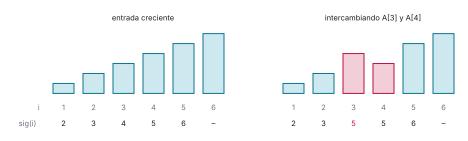

# Ejercicio 14

> 14. ★★★ Escoge un problema que no hayamos visto, recorre el ciclo completo de la
>     conferencia 2 sobre él y consigue que el algoritmo y la cota mínima coincidan. Es
>     el formato de la pregunta larga del examen final. (C2 a C5)

## 1. Problema

Dado un arreglo $A[1..n]$ de $n \ge 1$ elementos de un orden total, calcular para cada
posición $i$ su **siguiente mayor**: $\mathrm{sig}(i)$ es el menor $j > i$ con $A[j] > A[i]$,
o ninguno si no existe. Modelo: comparaciones; el algoritmo solo accede a los valores
preguntando si $A[i] < A[j]$, y su costo es el número de preguntas.

Tres precisiones. El mayor es estricto: en `5 5` el primero no tiene siguiente mayor. La
salida son $n$ posiciones, no valores. Y no es el sucesor de $A[i]$ en el orden de los
valores, que es otro problema: aquí importa el primero que aparece a la derecha, no el más
cercano en valor.

## 2. Fuerza bruta

Para cada $i$, recorrer $A[i+1..n]$ hasta el primer elemento mayor. Es correcta por
agotamiento y sirve de oráculo. Con $A$ decreciente ninguna posición encuentra mayor, y
cada $i$ hace $n - i$ comparaciones: $n(n-1)/2$ en total, $\Theta(n^2)$.

En [`codigo/ejercicio-14.py`](codigo/ejercicio-14.py):

```python
def fuerza_bruta(A):
    n, comparaciones, sig = len(A), 0, []
    for i in range(n):
        s = None
        for j in range(i + 1, n):
            comparaciones += 1
            if A[j] > A[i]:
                s = j
                break
        sig.append(s)
    return sig, comparaciones

print(f"{'n':>6} {'comparaciones con A decreciente':>32} {'n(n − 1)/2':>11}")
for n in [10, 100, 1000]:
    _, c = fuerza_bruta(list(range(n, 0, -1)))
    assert c == n * (n - 1) // 2
    print(f"{n:>6} {c:>32,} {n * (n - 1) // 2:>11,}")
```

```text
     n  comparaciones con A decreciente  n(n − 1)/2
    10                               45          45
   100                            4,950       4,950
  1000                          499,500     499,500
```

## 3. Algoritmo

Recorremos el arreglo de derecha a izquierda con una pila de posiciones ya procesadas, con
la más cercana en la cima. Al procesar $x = A[i]$, sacamos de la pila, mientras su cima
tenga valor menor o igual que $x$. Si la pila queda vacía, $i$ no tiene siguiente mayor; si
no, la cima es $\mathrm{sig}(i)$. Después apilamos $i$.

```python
def siguiente_mayor(A):
    n = len(A)
    sig = [None] * n             # None: no tiene siguiente mayor
    pila = []                    # posiciones a la derecha, cima = la más cercana
    for i in range(n - 1, -1, -1):
        while pila and A[pila[-1]] <= A[i]:
            pila.pop()
        if pila:
            sig[i] = pila[-1]
        pila.append(i)
    return sig

random.seed(14)
casos = 0
for _ in range(20_000):
    A = [random.randint(0, 9) for _ in range(random.randint(1, 30))]   # con repetidos
    assert siguiente_mayor(A) == fuerza_bruta(A)[0]
    casos += 1
print(f"{casos:,} arreglos al azar, con repetidos: 0 fallos contra la fuerza bruta")
```

```text
20,000 arreglos al azar, con repetidos: 0 fallos contra la fuerza bruta
```

![La pila al procesar A[3]](figuras/ejercicio-14-pila.svg)

*Figura 1. Procesando $x = A[3] = 5$ en $A = (7, 3, 5, 2, 4, 1, 6)$. En azul, las posiciones
de la pila; en rojo, las que salen porque su valor no supera a $x$. La cima que queda, la
posición 7, es $\mathrm{sig}(3)$.*

## 4. Correctitud

El invariante que uno escribe primero es la frase que queremos al final aplicada a lo ya
procesado: *después de procesar $A[i+1..n]$, $\mathrm{sig}[k]$ es correcto para toda
$k > i$*. Es verdadero, pero no es inductivo: la vuelta siguiente no lee `sig`, lee la
pila, y la frase no dice nada de la pila. En `2 1 3`, una pila que después de procesar
`1 3` tuviera solo la posición 2 cumpliría la frase, y la vuelta de la posición 1 sacaría
la posición 2, vería la pila vacía y diría que la posición 1 no tiene siguiente mayor,
cuando es la 3. Se refuerza diciendo qué posiciones hay en la pila.

- *Invariante:* después de procesar $A[i+1..n]$, $\mathrm{sig}[k]$ es correcto para toda
  $k > i$, y la pila contiene exactamente las posiciones $k > i$ tales que $A[k]$ es mayor
  que todos los valores de $A[i+1..k-1]$, con la menor en la cima.

  De ahí sale que los valores de la pila crecen estrictamente desde la cima hacia el fondo:
  si $k < k'$ están en la pila, $A[k']$ es mayor que todos los valores de
  $A[i+1..k'-1]$, y $A[k]$ es uno de ellos.
- *Inicialización:* con $i = n$ no hay posiciones mayores que $n$, y la pila está vacía.
- *Mantenimiento:* supongamos el invariante para $A[i+1..n]$ y procesemos $x = A[i]$. Sea
  $s$ la primera posición a la derecha de $i$ con $A[s] > x$, si existe. Las posiciones
  entre $i$ y $s$ valen a lo sumo $x$, así que $A[s]$ es mayor que todos los valores de
  $A[i+1..s-1]$ y, por el invariante, $s$ está en la pila. Encima de ella solo hay
  posiciones entre $i$ y $s$, que el `while` saca porque valen a lo sumo $x$, y el `while`
  se detiene en $s$ porque $A[s] > x$. Si $s$ no existe, todas las posiciones de la pila
  valen a lo sumo $x$ y el `while` la vacía. Hay dos casos, uno por rama del `if`:
  1. Si la pila no quedó vacía, su cima es $s$, y el algoritmo asigna $\mathrm{sig}[i] = s$,
     que es correcto.
  2. Si quedó vacía, $s$ no existe, y $\mathrm{sig}[i]$ se queda en `None`, que es correcto.

  Las demás respuestas no cambian. Falta la pila: después de procesar $A[i..n]$ tiene que
  contener $i$ y las posiciones $k > i$ cuyo valor es mayor que todos los de $A[i..k-1]$,
  es decir, las que estaban en la pila y además superan a $x$. Son exactamente las que el
  `while` no sacó, y al apilar $i$, la menor, queda en la cima. Así el invariante vale para
  $A[i..n]$.
- *Conclusión:* después de procesar $A[1..n]$, $\mathrm{sig}[k]$ es correcto para toda
  posición $k$.
- *Terminación:* el `for` recorre $n$ posiciones. Cada vuelta del `while` saca una posición
  de la pila, y cada posición se apila una sola vez, así que el `while` da a lo sumo $n$
  vueltas en total.

Comprobado con el algoritmo vigilado: después de cada posición, verifica las dos partes del
invariante contra la fuerza bruta.

```python
def siguiente_mayor_vigilado(A):
    # el mismo algoritmo, comprobando el invariante reforzado después de cada posición
    n = len(A)
    sig, pila = [None] * n, []
    correcto = fuerza_bruta(A)[0]
    for i in range(n - 1, -1, -1):
        while pila and A[pila[-1]] <= A[i]:
            pila.pop()
        if pila:
            sig[i] = pila[-1]
        pila.append(i)
        # sig correcto en A[i..n] y la pila = las k >= i mayores que todo A[i..k-1]
        assert all(sig[k] == correcto[k] for k in range(i, n))
        esperada = [k for k in range(i, n) if all(A[k] > A[j] for j in range(i, k))]
        assert pila == list(reversed(esperada))           # la menor en la cima
    return sig

random.seed(15)
prefijos = 0
for _ in range(5_000):
    A = [random.randint(0, 9) for _ in range(random.randint(1, 20))]
    siguiente_mayor_vigilado(A)
    prefijos += len(A)
print(f"invariante comprobado en {prefijos:,} sufijos, sin fallos")
```

```text
invariante comprobado en 53,274 sufijos, sin fallos
```

## 5. Costo

Contamos las comparaciones $A[\text{cima}] \le x$. Al procesar $A[i]$, si el ciclo saca
$p_i$ posiciones, hace $p_i$ comparaciones que dan sí y a lo sumo una que da no, la que lo
detiene con la pila no vacía: $c_i \le p_i + 1$, y $c_n = 0$. Una sola vuelta puede costar
$n - 1$: con $A = (n, 1, 2, \ldots, n-1)$ la última posición procesada, la 1, saca las
$n - 1$ restantes. Por eso se acota la suma, con el potencial $\Phi$ = número de posiciones
en la pila, que empieza en 0 y nunca es negativo. Procesar $A[i]$ apila una posición y saca
$p_i$, así que $\Phi$ cambia en $1 - p_i$, y el costo amortizado es

$$\hat{c}_i = c_i + (1 - p_i) \le (p_i + 1) + (1 - p_i) = 2, \qquad \hat{c}_n = 1.$$

Sumando, $\sum_i c_i = \sum_i \hat{c}_i - \Phi_{\text{final}} \le 2n - 1 - \Phi_{\text{final}} \le 2n - 2$,
porque la posición 1 queda en la pila al final. En total, a lo sumo $2n - 2$ comparaciones,
tiempo $O(n)$ y memoria $O(n)$ para la pila, además de la salida.

El peor caso sobre todas las permutaciones de hasta 8 elementos:

```python
def comparaciones_pila(A):
    # el mismo algoritmo, contando las comparaciones A[cima] <= x
    pila, c = [], 0
    for i in range(len(A) - 1, -1, -1):
        while pila:
            c += 1
            if A[pila[-1]] <= A[i]:
                pila.pop()
            else:
                break
        pila.append(i)
    return c

print(f"{'n':>3} {'peor caso (todas las permutaciones)':>36} {'2n − 2':>7}")
for n in range(1, 9):
    peor = max(comparaciones_pila(list(p)) for p in permutations(range(n)))
    assert peor <= 2 * n - 2
    print(f"{n:>3} {peor:>36} {2 * n - 2:>7}")
```

```text
  n  peor caso (todas las permutaciones)  2n − 2
  1                                    0       0
  2                                    1       2
  3                                    3       4
  4                                    5       6
  5                                    7       8
  6                                    9      10
  7                                   11      12
  8                                   13      14
```

## 6. Cota mínima

Todo algoritmo de comparaciones necesita $n - 1$ comparaciones en el peor caso. Tomemos la
entrada creciente $A[1] < A[2] < \cdots < A[n]$, con $\mathrm{sig}(i) = i + 1$ para $i < n$.
Para cada $i < n$, los valores de $A[i]$ y $A[i+1]$ son vecinos en el orden: ningún otro
valor queda entre ellos. Supongamos que un algoritmo termina sin haber comparado $A[i]$ con
$A[i+1]$, e intercambiemos esos dos valores. Toda comparación que hizo da la misma
respuesta: las que no tocan a ninguno de los dos no cambian, y las que comparan uno de ellos
con un tercero $A[k]$ tampoco, porque $A[k]$ es menor que los dos o mayor que los dos. El
algoritmo recibe las mismas respuestas, recorre el mismo camino y da la misma salida,
escrita en posiciones. Pero la respuesta correcta cambió: ahora $A[i] > A[i+1]$ y
$\mathrm{sig}(i) \ne i + 1$. El algoritmo se equivoca en una de las dos entradas. Por tanto
compara los $n - 1$ pares de vecinos, y como cada comparación es un solo par, hace al menos
$n - 1$.

Con $n = 6$, la entrada creciente y las cinco que resultan de intercambiar un par de
vecinos; cada una cambia la respuesta:

```python
def intercambiar_vecinos(n, i):
    # la entrada creciente con A[i] y A[i+1] intercambiados (posiciones desde 1)
    A = list(range(1, n + 1))
    A[i - 1], A[i] = A[i], A[i - 1]
    return A

n = 6
creciente = list(range(1, n + 1))
print(f"{'entrada':>20}  sig")
for A in [creciente] + [intercambiar_vecinos(n, i) for i in range(1, n)]:
    s = [None if k is None else k + 1 for k in siguiente_mayor(A)]
    print(f"{str(A):>20}  {' '.join('–' if k is None else str(k) for k in s)}")
# cada intercambio de vecinos cambia la respuesta: hay que comparar los n − 1 pares
assert all(siguiente_mayor(intercambiar_vecinos(n, i)) != siguiente_mayor(creciente)
           for i in range(1, n))
```

```text
             entrada  sig
  [1, 2, 3, 4, 5, 6]  2 3 4 5 6 –
  [2, 1, 3, 4, 5, 6]  3 3 4 5 6 –
  [1, 3, 2, 4, 5, 6]  2 4 4 5 6 –
  [1, 2, 4, 3, 5, 6]  2 3 5 5 6 –
  [1, 2, 3, 5, 4, 6]  2 3 4 6 6 –
  [1, 2, 3, 4, 6, 5]  2 3 4 5 – –
```



*Figura 2. Con $n = 6$: un algoritmo correcto tiene que comparar los cinco pares de vecinos.
Si no compara $A[3]$ con $A[4]$, intercambiarlos no cambia ninguna otra respuesta y
$\mathrm{sig}(3)$ pasa de 4 a 5.*

## 7. Conclusión

El algoritmo de la pila hace a lo sumo $2n - 2$ comparaciones, y todo algoritmo de
comparaciones necesita $n - 1$: los dos son $\Theta(n)$, y el algoritmo es óptimo salvo un
factor constante. Frente a la fuerza bruta, $\Theta(n^2)$, gana un factor $n$.
